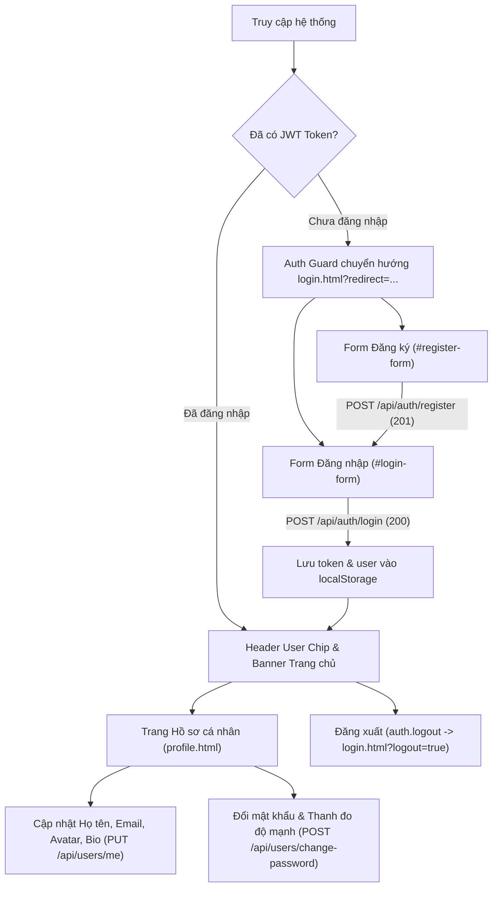

# Tài liệu Kiểm thử Frontend: Đăng ký, Đăng nhập & Quản lý Tài khoản Người dùng

- **Dự án:** Student Project Hub (Hệ thống Quản lý Đồ án & Bài tập nhóm Sinh viên CNTT PTIT)
- **Phạm vi kiểm thử:** Toàn bộ giao diện và logic xử lý phía Frontend liên quan đến **Xác thực (Đăng ký / Đăng nhập / Đăng xuất / Auth Guard)** và **Tài khoản & Người dùng (Hồ sơ cá nhân / Ảnh đại diện / Mô tả bản thân / Đổi mật khẩu / Header User Nav)**
- **Các file Frontend kiểm thử:**
  1. `frontend/pages/login.html` & `frontend/js/pages/login.js`
  2. `frontend/pages/profile.html` & `frontend/js/pages/profile.js`
  3. `frontend/index.html` & `frontend/js/pages/home.js`
  4. `frontend/js/layout.js`, `frontend/js/utils.js`, `frontend/js/api.js`

---

## 1. Sơ đồ luồng kiểm thử Frontend Tài khoản & Xác thực



---

## 2. Tổng hợp Kết quả Kiểm thử theo Nhóm chức năng

| STT | Nhóm chức năng Frontend | Số Test Case | Đạt (PASS) | Thất bại (FAIL) | Tỷ lệ đạt |
| :-: | :--- | :-: | :-: | :-: | :-: |
| 1 | Giao diện & Validate Form Đăng nhập (`login.html`, `login.js`) | 8 | 8 | 0 | 100% |
| 2 | Giao diện & Validate Form Đăng ký (`login.html`, `login.js`) | 7 | 7 | 0 | 100% |
| 3 | Quản lý Phiên, Auth Guard, Header User Chip & Đăng xuất (`layout.js`, `utils.js`, `home.js`) | 6 | 6 | 0 | 100% |
| 4 | Xem & Cập nhật Hồ sơ cá nhân, Avatar, Bio (`profile.html`, `profile.js`) | 8 | 8 | 0 | 100% |
| 5 | Đổi mật khẩu, Thanh đo độ mạnh & Hiển thị mật khẩu (`profile.html`, `profile.js`) | 7 | 7 | 0 | 100% |
| **Tổng** | **Toàn bộ phân hệ Tài khoản & Người dùng Frontend** | **36** | **36** | **0** | **100%** |

---

## 3. Bảng Test Case Chi Tiết (36 Test Cases)

### 3.1. Nhóm 1 — Chức năng Đăng nhập (`login.html` & `login.js`)

| Mã TC | Tiêu đề kiểm thử | Điều kiện tiên quyết | Các bước thực hiện | Dữ liệu kiểm thử | Kết quả mong đợi trên Frontend | Kết quả thực tế | Trạng thái |
| :--- | :--- | :--- | :--- | :--- | :--- | :--- | :---: |
| **FE_AUTH_01** | Hiển thị mặc định màn hình Đăng nhập | Mở `pages/login.html` khi chưa đăng nhập | 1. Mở `pages/login.html`<br>2. Quan sát trạng thái hiển thị của `#login-section` và `#register-section` | URL: `pages/login.html` | `#login-section` hiển thị (`display: block`), `#register-section` ẩn (`display: none`), tiêu đề trang là `Đăng nhập \| ...` | Đúng như mong đợi | **PASS** |
| **FE_AUTH_02** | Validate bỏ trống Email và Mật khẩu khi Đăng nhập | Đang ở form Đăng nhập | 1. Để trống `#login-email` và `#login-password`<br>2. Bấm nút `Đăng nhập` (`#btn-login`) | Email: `""`<br>Password: `""` | Ô `#login-email` và `#login-password` thêm class `.is-invalid`; hiển thị lỗi `#login-email-error` (*"Vui lòng nhập địa chỉ email"*) và `#login-password-error` (*"Vui lòng nhập mật khẩu"*); không gửi request API | Đúng như mong đợi | **PASS** |
| **FE_AUTH_03** | Validate Email sai định dạng bằng Regex chuẩn | Đang ở form Đăng nhập | 1. Nhập email sai cú pháp vào `#login-email`<br>2. Nhập mật khẩu hợp lệ<br>3. Bấm `Đăng nhập` | Email: `a@.b`, `@.`, `sinhvien@`<br>Password: `password123` | `EMAIL_REGEX` chặn lại trước khi gọi API; hiển thị lỗi `#login-email-error`: *"Email không đúng định dạng (VD: ten@ptit.edu.vn)"* | Đúng như mong đợi (Đã sửa `BUG-05a`) | **PASS** |
| **FE_AUTH_04** | Validate Mật khẩu đăng nhập ngắn hơn 8 ký tự | Đang ở form Đăng nhập | 1. Nhập email hợp lệ<br>2. Nhập mật khẩu dưới 8 ký tự<br>3. Bấm `Đăng nhập` | Email: `sv@ptit.edu.vn`<br>Password: `123456` | Chặn submit, hiển thị lỗi `#login-password-error`: *"Mật khẩu phải có tối thiểu 8 ký tự"* | Đúng như mong đợi | **PASS** |
| **FE_AUTH_05** | Tự động xóa cảnh báo lỗi khi người dùng gõ phím | Form Đăng nhập đang hiển thị lỗi `.is-invalid` | 1. Gõ ký tự mới vào `#login-email` hoặc `#login-password` | Sự kiện `input` | Class `.is-invalid` trên ô input và `.is-visible` trên thẻ `.form-error` tự động được gỡ bỏ ngay khi gõ | Đúng như mong đợi | **PASS** |
| **FE_AUTH_06** | Nút "Điền nhanh tài khoản mẫu" | Đang ở form Đăng nhập | 1. Bấm nút `#btn-quick-fill` (*"Điền nhanh tài khoản mẫu"*) | Click `#btn-quick-fill` | `#login-email` tự điền `truongnhom1@example.com`, `#login-password` tự điền `password123`, xóa mọi trạng thái lỗi cũ | Đúng như mong đợi | **PASS** |
| **FE_AUTH_07** | Đăng nhập thành công & Lưu phiên làm việc | Backend đang chạy hoặc chế độ demo sẵn sàng | 1. Nhập email và mật khẩu đúng<br>2. Bấm `Đăng nhập` | Email: `sinhvien1@example.com`<br>Password: `password123` | Nút đổi thành *"Đang đăng nhập..."* (disabled), lưu `token` và `user` vào `localStorage`, hiện Toast xanh *"Đăng nhập thành công!"*, chuyển hướng sang `projects.html` sau 700ms | Đúng như mong đợi | **PASS** |
| **FE_AUTH_08** | Đăng nhập thất bại khi sai thông tin xác thực | Backend đang chạy | 1. Nhập email đúng nhưng mật khẩu sai<br>2. Bấm `Đăng nhập` | Email: `sinhvien1@example.com`<br>Password: `saimatkhau99` | API trả `401`, Frontend bắt lỗi và hiện Toast đỏ: *"Email hoặc mật khẩu không chính xác."*, nút `#btn-login` mở khóa trở lại | Đúng như mong đợi | **PASS** |

---

### 3.2. Nhóm 2 — Chức năng Đăng ký Tài khoản mới (`login.html` & `login.js`)

| Mã TC | Tiêu đề kiểm thử | Điều kiện tiên quyết | Các bước thực hiện | Dữ liệu kiểm thử | Kết quả mong đợi trên Frontend | Kết quả thực tế | Trạng thái |
| :--- | :--- | :--- | :--- | :--- | :--- | :--- | :---: |
| **FE_REG_01** | Chuyển đổi qua lại Đăng nhập $\leftrightarrow$ Đăng ký và bảo toàn `?redirect=` | Mở `login.html?redirect=projects.html` | 1. Bấm `#link-show-register` (*"Đăng ký ngay"*)<br>2. Bấm `#link-show-login` (*"Đăng nhập ngay"*) | URL có `?redirect=projects.html` | Khi sang Đăng ký: URL thêm `#register`, focus vào `#reg-fullname`. Khi quay về Đăng nhập: xóa `#register` nhưng **giữ nguyên** `?redirect=projects.html` trên URL | Đúng như mong đợi (Đã sửa `BUG-05b`) | **PASS** |
| **FE_REG_02** | Mở trực tiếp form Đăng ký qua URL hash `#register` | Chưa đăng nhập | 1. Truy cập thẳng URL `pages/login.html#register` | Hash `#register` | Tự động gọi `switchToRegister()`, hiển thị `#register-section` và ẩn `#login-section` | Đúng như mong đợi | **PASS** |
| **FE_REG_03** | Validate bỏ trống Họ và tên khi Đăng ký | Đang ở form Đăng ký | 1. Để trống `#reg-fullname` (hoặc chỉ nhập khoảng trắng)<br>2. Bấm `Đăng ký tài khoản` | Fullname: `"   "` | Hiển thị lỗi `#reg-fullname-error`: *"Vui lòng nhập họ và tên"* | Đúng như mong đợi | **PASS** |
| **FE_REG_04** | Validate Email bỏ trống hoặc sai định dạng khi Đăng ký | Đang ở form Đăng ký | 1. Để trống `#reg-email` -> Submit<br>2. Nhập `a@.b` -> Submit | Email: `""`, `"a@.b"` | Khi trống hiện *"Vui lòng nhập địa chỉ email"*; khi sai cú pháp hiện *"Email không đúng định dạng (VD: ten@ptit.edu.vn)"* | Đúng như mong đợi | **PASS** |
| **FE_REG_05** | Validate Mật khẩu đăng ký ngắn hơn 8 ký tự | Đang ở form Đăng ký | 1. Nhập mật khẩu `< 8` ký tự vào `#reg-password`<br>2. Bấm `Đăng ký tài khoản` | Password: `"123456"` | Hiển thị lỗi `#reg-password-error`: *"Mật khẩu phải có tối thiểu 8 ký tự"* (đồng bộ với `min_length=8` trên Backend) | Đúng như mong đợi (Đã sửa `BUG-08`) | **PASS** |
| **FE_REG_06** | Validate Nhập lại mật khẩu bỏ trống hoặc không khớp | Đang ở form Đăng ký | 1. Nhập `#reg-password` là `Ptit@2026`<br>2. Để trống `#reg-confirm` hoặc nhập `Ptit@2025`<br>3. Bấm `Đăng ký tài khoản` | Password: `Ptit@2026`<br>Confirm: `Ptit@2025` | Khi trống báo *"Vui lòng xác nhận lại mật khẩu"*; khi lệch báo *"Mật khẩu nhập lại không khớp"* | Đúng như mong đợi | **PASS** |
| **FE_REG_07** | Đăng ký thành công & Tự động điền Email sang form Đăng nhập | Đang ở form Đăng ký | 1. Nhập đầy đủ Họ tên, Email mới, Mật khẩu $\ge 8$ ký tự, Xác nhận khớp<br>2. Bấm `Đăng ký tài khoản` | Fullname: `Nguyễn Văn Mới`<br>Email: `moi@ptit.edu.vn`<br>Password: `Ptit@2026` | Gọi `POST /api/auth/register`, hiện Toast xanh *"Đăng ký tài khoản thành công! Hãy đăng nhập."*, tự chuyển về form Đăng nhập, điền sẵn `moi@ptit.edu.vn` vào `#login-email` và focus vào `#login-password` | Đúng như mong đợi | **PASS** |

---

### 3.3. Nhóm 3 — Quản lý Phiên, Auth Guard, Header User Chip & Đăng xuất (`layout.js`, `utils.js`, `home.js`)

| Mã TC | Tiêu đề kiểm thử | Điều kiện tiên quyết | Các bước thực hiện | Dữ liệu kiểm thử | Kết quả mong đợi trên Frontend | Kết quả thực tế | Trạng thái |
| :--- | :--- | :--- | :--- | :--- | :--- | :--- | :---: |
| **FE_SESS_01** | Auth Guard chặn truy cập trái phép khi chưa đăng nhập | `localStorage.getItem("token")` là `null` | 1. Mở trực tiếp `pages/projects.html`, `pages/tasks.html`, `pages/members.html` hoặc `pages/profile.html` | Chưa có token | Tự động `window.location.replace` sang `login.html?redirect=...&reason=auth_required` và hiện Toast đỏ *"Vui lòng đăng nhập để truy cập trang quản lý dự án!"* | Đúng như mong đợi | **PASS** |
| **FE_SESS_02** | Chuyển hướng ngược về trang đích (`?redirect=`) sau khi đăng nhập | Bị Auth Guard chuyển về `login.html?redirect=%2Fpages%2Fprofile.html` | 1. Đăng nhập thành công trên `login.html` | `redirect=/pages/profile.html` | Sau khi đăng nhập thành công, giải mã `decodeURIComponent(redirectTarget)` và chuyển thẳng về `pages/profile.html` | Đúng như mong đợi | **PASS** |
| **FE_SESS_03** | Tự động bỏ qua trang Login khi đã đăng nhập (`redirectIfAuth`) | Đã có `token` hợp lệ trong `localStorage` | 1. Mở lại `pages/login.html` (không có `?logout=true`) | Đã có `token` | Hàm `auth.redirectIfAuth()` tự động chuyển hướng người dùng thẳng vào `projects.html` | Đúng như mong đợi | **PASS** |
| **FE_SESS_04** | Hiển thị Banner tài khoản trên Trang chủ (`index.html`) | Kiểm tra ở cả 2 trạng thái: Chưa đăng nhập & Đã đăng nhập | 1. Mở `index.html` khi chưa login<br>2. Đăng nhập rồi mở lại `index.html` | `#home-auth-banner` | Chưa login: hiện khung vàng *"Bạn chưa đăng nhập..."* + nút `Đăng nhập ngay`. Đã login: hiện khung xanh *"Chào mừng {Tên}!"* + nút `Vào Dự án của tôi` + nút `Đăng xuất` | Đúng như mong đợi | **PASS** |
| **FE_SESS_05** | Hiển thị User Chip trên Header chung (`layout.js`) | Đã đăng nhập với user `Lê Quang Huy` | 1. Quan sát `#app-header` trên bất kỳ trang nào<br>2. Bấm vào chip tên người dùng (`.user-profile-link`) | `full_name: "Lê Quang Huy"` | Ẩn mục `Đăng nhập` trên thanh menu; hiển thị `.user-avatar-chip` với chữ viết tắt **`LH`**, tên **`Lê Quang Huy`** và nút `Đăng xuất`; bấm vào tên mở trang `pages/profile.html` | Đúng như mong đợi | **PASS** |
| **FE_SESS_06** | Đăng xuất khỏi tài khoản (`auth.logout()`) | Đang đăng nhập ở bất kỳ trang nào | 1. Bấm nút `Đăng xuất` (`#btn-logout`) trên Header | Click `#btn-logout` | Xóa `token` và `user` khỏi `localStorage`, chuyển về `login.html?logout=true`, hiện Toast *"Đã đăng xuất thành công khỏi hệ thống!"* và tự xóa `?logout=true` khỏi thanh địa chỉ | Đúng như mong đợi | **PASS** |

---

### 3.4. Nhóm 4 — Hồ sơ cá nhân, Ảnh đại diện & Mô tả bản thân (`profile.html` & `profile.js`)

| Mã TC | Tiêu đề kiểm thử | Điều kiện tiên quyết | Các bước thực hiện | Dữ liệu kiểm thử | Kết quả mong đợi trên Frontend | Kết quả thực tế | Trạng thái |
| :--- | :--- | :--- | :--- | :--- | :--- | :--- | :---: |
| **FE_PROF_01** | Tải và hiển thị thông tin Hồ sơ cá nhân (`GET /api/users/me`) | Đã đăng nhập, mở `pages/profile.html` | 1. Truy cập `pages/profile.html`<br>2. Quan sát cột tóm tắt bên trái và form bên phải | Dữ liệu từ `/api/users/me` hoặc `localStorage` | Hiển thị đầy đủ: Avatar/Initials, Họ tên (`#summary-fullname`), Email (`#summary-email`), Vai trò badge (`#summary-role`), Trạng thái (`Đang hoạt động`), Bio (`#summary-bio`), Mã ID, Ngày tạo, Ngày cập nhật; điền sẵn dữ liệu vào các ô input | Đúng như mong đợi | **PASS** |
| **FE_PROF_02** | Bộ đếm ký tự thời gian thực cho Họ tên (`100`) và Bio (`1000`) | Đang ở trang `profile.html` | 1. Gõ thêm hoặc xóa ký tự trong `#profile-fullname` và `#profile-bio` | Chuỗi 25 ký tự họ tên, 120 ký tự bio | `#fullname-counter` cập nhật tức thì `25/100`; `#bio-counter` cập nhật tức thì `120/1000` | Đúng như mong đợi | **PASS** |
| **FE_PROF_03** | Xem trước trực tiếp Ảnh đại diện (`avatar_url`) và xử lý lỗi ảnh hỏng | Đang ở trang `profile.html` | 1. Nhập URL ảnh hợp lệ vào `#profile-avatar-url`<br>2. Nhập URL ảnh không tồn tại / lỗi<br>3. Xóa trắng ô URL ảnh | URL hợp lệ vs URL lỗi `https://invalid.domain/404.png` | Khi nhập URL `http(s)://`: tạo thẻ `` hiển thị ảnh ngay trong `#summary-avatar`. Nếu ảnh lỗi (`onerror`) hoặc xóa trắng: tự động fallback hiển thị chữ cái viết tắt họ tên (`getInitials`) | Đúng như mong đợi | **PASS** |
| **FE_PROF_04** | Validate Họ và tên rỗng hoặc vượt quá 100 ký tự | Đang ở form Thông tin cá nhân | 1. Xóa trắng `#profile-fullname` (hoặc nhập toàn dấu cách)<br>2. Bấm `Lưu thay đổi` (`#btn-save-profile`) | `full_name: "   "` | Báo lỗi inline `#profile-fullname-error`: *"Vui lòng nhập họ và tên."* và banner đỏ *"Vui lòng kiểm tra lại các trường thông tin chưa hợp lệ."* | Đúng như mong đợi | **PASS** |
| **FE_PROF_05** | Validate Email cá nhân rỗng hoặc sai định dạng | Đang ở form Thông tin cá nhân | 1. Nhập email sai định dạng `abc@xyz` vào `#profile-email`<br>2. Bấm `Lưu thay đổi` | `email: "abc@xyz"` | Báo lỗi inline `#profile-email-error`: *"Định dạng email không hợp lệ (VD: ten@ptit.edu.vn)."* | Đúng như mong đợi | **PASS** |
| **FE_PROF_06** | Validate URL ảnh đại diện sai giao thức | Đang ở form Thông tin cá nhân | 1. Nhập đường dẫn không bắt đầu bằng `http://` hoặc `https://` vào `#profile-avatar-url`<br>2. Bấm `Lưu thay đổi` | `avatar_url: "ftp://example.com/a.png"` | Báo lỗi inline `#profile-avatar-error`: *"URL ảnh đại diện phải bắt đầu bằng http:// hoặc https://"* | Đúng như mong đợi | **PASS** |
| **FE_PROF_07** | Cập nhật Hồ sơ thành công & Đồng bộ tức thì lên Header | Đang ở form Thông tin cá nhân | 1. Sửa Họ tên thành `Nguyễn Minh Đức`, sửa Bio, nhập Avatar URL hợp lệ<br>2. Bấm `Lưu thay đổi` | `full_name: "Nguyễn Minh Đức"`<br>`bio: "Sinh viên CNTT PTIT"` | Gọi `PUT /api/users/me`, cập nhật thẻ tóm tắt bên trái, lưu `localStorage`, đồng thời **cập nhật ngay tên `Nguyễn Minh Đức` và chữ viết tắt `NĐ` trên Header** mà không cần F5; hiện thông báo xanh *"Cập nhật thông tin cá nhân thành công!"* | Đúng như mong đợi | **PASS** |
| **FE_PROF_08** | Nút "Khôi phục" (`#btn-reset-profile`) hoàn tác dữ liệu đang sửa | Đang ở form Thông tin cá nhân | 1. Sửa Họ tên, Email, Bio sang giá trị khác (hoặc gây lỗi validation)<br>2. Bấm nút `Khôi phục` (`#btn-reset-profile`) | Click `#btn-reset-profile` | Toàn bộ các ô input, bộ đếm ký tự và ảnh preview khôi phục về đúng dữ liệu `currentProfile` trước khi sửa; xóa sạch các thông báo lỗi | Đúng như mong đợi | **PASS** |

---

### 3.5. Nhóm 5 — Đổi mật khẩu, Thanh đo độ mạnh & Hiển thị mật khẩu (`profile.html` & `profile.js`)

| Mã TC | Tiêu đề kiểm thử | Điều kiện tiên quyết | Các bước thực hiện | Dữ liệu kiểm thử | Kết quả mong đợi trên Frontend | Kết quả thực tế | Trạng thái |
| :--- | :--- | :--- | :--- | :--- | :--- | :--- | :---: |
| **FE_PW_01** | Thanh đo độ mạnh mật khẩu thời gian thực (`updatePasswordStrength`) | Đang ở khu vực Đổi mật khẩu trên `profile.html` | 1. Để trống `#new-password`<br>2. Nhập `12345`<br>3. Nhập `Abcdef12` (thiếu ký tự đặc biệt)<br>4. Nhập `Ptit@2026` (đủ 4 nhóm + $\ge 8$ ký tự) | `""` $\rightarrow$ `"12345"` $\rightarrow$ `"Abcdef12"` $\rightarrow$ `"Ptit@2026"` | - Trống: `0%`, *"Độ mạnh mật khẩu: Chưa nhập"*<br>- Yếu: `33%` (đỏ), *"Độ mạnh mật khẩu: Yếu (chưa đủ điều kiện lưu)"*<br>- Trung bình: `66%` (vàng), *"Độ mạnh mật khẩu: Trung bình (cần đủ chữ hoa, thường, số, ký tự đặc biệt)"*<br>- Mạnh: `100%` (xanh lá), *"Độ mạnh mật khẩu: Mạnh (đạt chuẩn bảo mật)"* | Đúng như mong đợi | **PASS** |
| **FE_PW_02** | Nút "Hiện / Ẩn" mật khẩu trên cả 3 ô mật khẩu | Đang ở form Đổi mật khẩu | 1. Bấm nút `Hiện` (`.btn-toggle-pw`) cạnh `#old-password`, `#new-password`, `#confirm-password`<br>2. Bấm lại nút `Ẩn` | Click `.btn-toggle-pw` | Khi bấm `Hiện`: thuộc tính `type` của ô input tương ứng đổi từ `"password"` sang `"text"`, nhãn nút đổi thành `"Ẩn"`. Bấm lần nữa đổi ngược lại `"password"` và `"Hiện"` | Đúng như mong đợi | **PASS** |
| **FE_PW_03** | Chặn mật khẩu mới yếu & Hiển thị đúng thông báo chuẩn | Đang ở form Đổi mật khẩu | 1. Nhập mật khẩu hiện tại<br>2. Nhập mật khẩu mới yếu (`123456`, `12345678`, `matkhaumoi123`, `MatKhau123`)<br>3. Nhập xác nhận khớp và bấm `Cập nhật mật khẩu` | `new_password: "12345678"` | Chặn không lưu mật khẩu mới; hiển thị thông báo lỗi: **"Mật khẩu mới quá yếu vui lòng chọn mật khẩu mạnh hơn!"** (khi trả từ BE) hoặc chi tiết tiêu chí thiếu ngay dưới ô `#new-password` | Đúng như mong đợi | **PASS** |
| **FE_PW_04** | Validate Mật khẩu mới trùng với Mật khẩu hiện tại | Đang ở form Đổi mật khẩu | 1. Nhập `#old-password`: `Ptit@2026`<br>2. Nhập `#new-password`: `Ptit@2026`<br>3. Nhập `#confirm-password`: `Ptit@2026`<br>4. Bấm `Cập nhật mật khẩu` | `old_password == new_password` | Chặn ngay trên FE, hiển thị lỗi tại `#new-password-error`: *"Mật khẩu mới không được trùng với mật khẩu hiện tại."* | Đúng như mong đợi | **PASS** |
| **FE_PW_05** | Validate Xác nhận mật khẩu mới không khớp | Đang ở form Đổi mật khẩu | 1. Nhập `#old-password`: `MatKhauCu@123`<br>2. Nhập `#new-password`: `MatKhauMoi@456`<br>3. Nhập `#confirm-password`: `MatKhauKhac@789`<br>4. Bấm `Cập nhật mật khẩu` | `confirm_password != new_password` | Chặn submit, hiển thị lỗi tại `#confirm-password-error`: *"Xác nhận mật khẩu mới không khớp."* | Đúng như mong đợi | **PASS** |
| **FE_PW_06** | Xử lý lỗi khi nhập sai Mật khẩu hiện tại từ Backend (`400`) | Backend đang chạy, đã đăng nhập | 1. Nhập `#old-password` sai với DB<br>2. Nhập `#new-password` và `#confirm-password` hợp lệ (`MatKhauMoi@456`)<br>3. Bấm `Cập nhật mật khẩu` | `old_password: "SaiMatKhau@111"` | API trả `400 Bad Request`, Frontend đánh dấu đỏ ô `#old-password`, hiển thị lỗi *"Mật khẩu hiện tại không chính xác."* ở cả `#old-password-error` và `#password-alert` | Đúng như mong đợi | **PASS** |
| **FE_PW_07** | Đổi mật khẩu thành công (`POST /api/users/change-password`) | Đã đăng nhập, nhập đúng mật khẩu hiện tại | 1. Nhập `#old-password` đúng<br>2. Nhập `#new-password` mạnh (`MatKhauMoi@456`) và `#confirm-password` khớp<br>3. Bấm `Cập nhật mật khẩu` | `new_password: "MatKhauMoi@456"` | Gọi `POST /api/users/change-password` trả `200 OK`, form tự động `reset()`, thanh độ mạnh về *"Chưa nhập"*, hiện thông báo xanh `#password-alert`: *"Đổi mật khẩu thành công!"* | Đúng như mong đợi | **PASS** |

---

## 4. Hướng dẫn Chạy Kiểm thử Thực tế & Tự động

1. **Kiểm thử trực tiếp trên trình duyệt (Live Server / FastAPI Static Mount)**:
   - Khởi động Backend (tự động phục vụ cả Frontend tại `/`):
     ```powershell
     cd backend
     .\venv\Scripts\uvicorn app.main:app --reload
     ```
   - Mở trình duyệt tại:
     - Trang Đăng nhập / Đăng ký: `http://127.0.0.1:8000/pages/login.html`
     - Trang Hồ sơ cá nhân & Đổi mật khẩu: `http://127.0.0.1:8000/pages/profile.html`

2. **Kiểm thử tự động các API & Validation đồng bộ với Frontend (`pytest`)**:
   ```powershell
   $env:PYTHONPATH="backend"; backend\venv\Scripts\pytest backend/tests/test_auth_validation.py backend/tests/test_user_profile.py backend/tests/test_change_password_api.py -v
   ```

