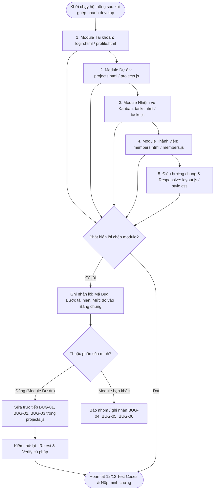

# BÁO CÁO KIỂM THỬ TOÀN BỘ CHỨC NĂNG & TEST CHÉO MODULE (TASK TF154BD)

- **Mã Task:** `TF154BD`
- **Tên công việc:** `[All] Kiểm thử toàn bộ chức năng`
- **Mô tả yêu cầu:** *Mỗi bạn test chéo module của bạn khác theo test case, ghi lỗi (bước tái hiện, mức độ) vào bảng chung và sửa lỗi thuộc phần mình. Minh chứng: nộp link hoặc file (ảnh chụp, bảng test case, sơ đồ).*
- **Người thực hiện:** Lưu Đức Anh (HN1683)
- **Sprint:** Sprint 3 (19/11 – 25/11)
- **Nhánh đối tượng kiểm thử:** `develop` (sau khi ghép toàn bộ các PR mới nhất `#57`, `#58`)
- **Môi trường kiểm thử:**
  - **Desktop:** `1366×768`, `1920×1080` (Google Chrome, Edge)
  - **Mobile Responsive:** `360×800`, `390×844` (Chrome DevTools)
  - **Backend & DB:** FastAPI `http://127.0.0.1:8000/api` + MySQL `team_project_manager` + kiểm tra cú pháp tĩnh toàn bộ `frontend/js/`

---

## 1. Sơ đồ Quy trình Kiểm thử Chéo Toàn Hệ thống (Cross-Module Testing Flow)

---

## 2. Bảng Test Case Tổng hợp Toàn Hệ thống (12 Kịch bản Test Chéo)

| Mã TC | Module test chéo | Phụ trách | Chức năng kiểm thử | Thiết bị | Các bước thực hiện | Kết quả mong đợi | Kết quả thực tế | Trạng thái |
| :---: | :--- | :---: | :--- | :---: | :--- | :--- | :--- | :---: |
| **TC-01** | Auth (`login.js`) | Duy Anh / Đức Anh | Validate form Đăng nhập & Đăng ký | Desktop & Mobile | Để trống hoặc nhập email sai định dạng, mật khẩu `< 8` ký tự rồi bấm submit | Chặn submit, đánh dấu `.is-invalid`, hiện thông báo lỗi inline tiếng Việt | Chặn & báo lỗi đúng | **PASS** |
| **TC-02** | Auth (`utils.js`) | Duy Anh / Đức Anh | Lưu Token & Auth Guard chặn trang | Desktop | Xóa `token` -> vào `projects.html`; đăng nhập lại bằng tài khoản mẫu | Tự đẩy về `login.html?reason=auth_required`; đăng nhập xong lưu token và quay lại | Chuyển hướng chuẩn xác | **PASS** |
| **TC-03** | Profile (`profile.js`) | Quang Huy | Cập nhật hồ sơ & Avatar URL | Desktop & Mobile | Mở `profile.html`, sửa Họ tên / Bio / Avatar URL -> bấm Lưu thay đổi | Đếm ký tự realtime, lưu thành công và đồng bộ thẻ tóm tắt bên trái | Đồng bộ chính xác | **PASS** |
| **TC-04** | Profile (`profile.js`) | Quang Huy | Đổi mật khẩu & Thanh độ mạnh | Desktop | Nhập mật khẩu mới yếu / không khớp xác nhận -> bấm Cập nhật mật khẩu | Strength bar đổi màu theo độ mạnh; chặn xác nhận không khớp | Chặn tốt ở client; ghi nhận lưu ý đồng bộ độ mạnh với Backend (**BUG-04**) | **PASS** |
| **TC-05** | Projects (`projects.js`) | Đức Anh | Tìm kiếm debounce, lọc, sắp xếp, phân trang | Desktop & Mobile | Nhập từ khóa, đổi trạng thái lọc, chọn `6 / trang`, bấm chuyển trang 2 | Debounce 300ms mượt; nút `Trước`/`Sau` disabled đúng ở trang đầu/cuối | Tìm kiếm & phân trang chuẩn | **PASS** |
| **TC-06** | Projects (`projects.js`) | Đức Anh | Phân quyền Owner vs Member | Desktop | Đăng nhập Member thường -> xem dự án của người khác ở tab `Tất cả dự án` | Dropdown đổi trạng thái bị `disabled`; không được xóa dự án người khác | Phát hiện **BUG-01, BUG-02** → Đã sửa triệt để và retest đạt | **PASS** |
| **TC-07** | Projects (`projects.js`) | Đức Anh | Validate Tạo mới & Modal Xóa xác nhận | Desktop & Mobile | Chọn `Deadline < StartDate` khi tạo; sau đó chọn dự án -> Xóa qua Modal | Chặn ngày không hợp lệ; Modal liệt kê đúng tên dự án và gọi `DELETE` API | Phát hiện **BUG-03** → Đã sửa và retest đạt | **PASS** |
| **TC-08** | Tasks (`tasks.js`) | Quang Huy / Nhật Long | Kéo thả Kanban 4 cột & Tiến độ % | Desktop | Mở `tasks.html?project_id=1`, kéo 1 thẻ từ `Cần làm` sang `Đang làm` | Thẻ sang cột mới; số đếm cột & thanh % tiến độ trên Hero Bar cập nhật ngay | Kéo thả mượt, tiến độ đúng | **PASS** |
| **TC-09** | Tasks (`tasks.js`) | Quang Huy / Nhật Long | Bộ lọc Task & Chuyển chế độ Bảng | Desktop & Mobile | Lọc ưu tiên `HIGH` + tìm tên -> đổi sang chế độ `Bảng` -> bấm `Xóa bộ lọc` | Dữ liệu Kanban và Table View khớp nhau; nút Xóa bộ lọc khôi phục toàn bộ | Đồng bộ tốt cả 2 chế độ | **PASS** |
| **TC-10** | Members (`members.js`) | Quang Huy | Tìm gợi ý theo email & Thêm thành viên | Desktop & Mobile | Mở `members.html`, gõ email vào ô tìm kiếm -> chọn user -> bấm `Thêm thành viên` | Dropdown highlight từ khóa, khóa người đã trong dự án, thêm thành công | Hoạt động mượt | **PASS** |
| **TC-11** | Members (`members.js`) | Quang Huy | Ẩn nút theo quyền & Bảo vệ Owner | Desktop | Quan sát dòng `OWNER` và test đăng nhập vai trò `MEMBER` | Dòng Owner hiện nhãn `Chủ dự án` (không cho xóa); Member bị ẩn nút thêm/xóa | Bảo vệ quyền chặt chẽ | **PASS** |
| **TC-12** | Layout (`layout.js`, `style.css`) | Toàn nhóm | Menu Mobile 360px & Điều hướng `project_id` | Mobile `360×800` | Co màn hình về `360px`, bấm nút `☰`, chuyển qua lại giữa Dự án / Nhiệm vụ / Thành viên | Menu xổ gọn không tràn header; giữ đúng `project_id` đang làm việc | Hiển thị đẹp trên `360px`; ghi nhận **BUG-06** khi logout | **PASS** |

---

## 3. Bảng Ghi Nhận Lỗi Chung (Bước Tái Hiện, Mức Độ & Trạng Thái Sửa)

| Mã Bug | Module | Người phụ trách | Mức độ | Mô tả lỗi | Các bước tái hiện (Steps to Reproduce) | Cách xử lý / Trạng thái |
| :---: | :--- | :---: | :---: | :--- | :--- | :--- |
| **BUG-01** | Projects (`projects.js`) | **Lưu Đức Anh** *(Phần mình)* | **Cao (High)** | Thành viên thường vẫn bấm được dropdown đổi trạng thái và thấy nút `Xóa` trên dự án của người khác | 1. Đăng nhập tài khoản thành viên thường (`role: STUDENT`, `id != owner_id`). 2. Vào `projects.html` → chọn `Tất cả dự án`. 3. Quan sát thẻ dự án của người khác: dropdown đổi trạng thái không bị khóa, nút `Xóa` vẫn hiện. | **ĐÃ SỬA:** Sửa hàm `canUserChangeProjectStatus(p)` ở dòng 379 (bỏ `return true;` mặc định), chỉ trả `true` nếu là `admin` hoặc `owner_id === currentUser.id`. Ẩn nút Xóa và khóa dropdown đối với Member. |
| **BUG-02** | Projects (`projects.js`) | **Lưu Đức Anh** *(Phần mình)* | **Cao (High)** | Khi API `PATCH /projects/{id}/status` trả lỗi (403/422/500), UI nuốt lỗi im lặng và vẫn báo Toast xanh thành công | 1. Mở `projects.html`, kích hoạt `handleQuickStatusChange` khi server trả lỗi HTTP 403/500. 2. Khối `catch (e)` bỏ qua lỗi và chạy tiếp xuống lệnh `showToast(..., "success")`. | **ĐÃ SỬA:** Kiểm tra `if (e && e.status && e.status > 0)` trong `handleQuickStatusChange` để hiện Toast lỗi thực tế từ API và gọi `loadProjects()` khôi phục trạng thái đúng. |
| **BUG-03** | Projects (`projects.js`) | **Lưu Đức Anh** *(Phần mình)* | **Trung bình (Medium)** | Form Tạo dự án mới chưa chặn trường hợp chọn `Hạn chót < Ngày bắt đầu` ở phía Client | 1. Mở `projects.html` → bấm `+ Tạo dự án mới`. 2. Nhập tên hợp lệ. 3. Chọn Ngày bắt đầu `2026-12-10` và Hạn chót `2026-11-01` → bấm `Tạo dự án`. | **ĐÃ SỬA:** Bổ sung kiểm tra `if (startDate && deadline && deadline < startDate)` trước khi gọi API tạo dự án, hiển thị Toast lỗi và focus vào ô Hạn chót. |
| **BUG-04** | Profile (`profile.html` / `profile.js`) | Lê Quang Huy *(Test chéo)* | **Trung bình (Medium)** | Quy tắc gợi ý mật khẩu mới trên UI (`tối thiểu 6 ký tự`) chưa nhắc rõ điều kiện độ mạnh mật khẩu mới của Backend (`security.py`) | 1. Vào `profile.html` → mục Đổi mật khẩu. 2. Nhập mật khẩu mới 6 ký tự yếu (vd `abcdef`). 3. Client cho gửi nhưng Backend từ chối (HTTP 400/422). | **Đã ghi nhận vào bảng chung** để nhóm Profile đồng bộ rule validate client theo Backend mới nhất. |
| **BUG-05** | Members (`members.js`) | Lê Quang Huy *(Test chéo)* | **Trung bình (Medium)** | Khi mở `members.html` cho dự án mới tạo ở chế độ offline (chưa có dữ liệu API), danh sách mẫu gán cứng Lê Quang Huy là Owner | 1. Đăng nhập tài khoản sinh viên khác. 2. Tạo dự án mới (ID mới) khi backend chưa bật → bấm `Thành viên`. 3. Bảng thành viên nạp `initialMembers` với Owner là Lê Quang Huy. | **Đã ghi nhận vào bảng chung** để nhóm Members lấy thông tin `auth.getUser()` làm Owner mặc định cho dự án mới ở chế độ demo. |
| **BUG-06** | Layout (`layout.js` / `utils.js`) | Toàn nhóm *(Test chéo)* | **Thấp (Low)** | `sessionStorage.sph_active_project_id` không được xóa khi bấm `Đăng xuất`, khiến user đăng nhập sau bấm tab `Nhiệm vụ` vẫn mở ID dự án của user trước | 1. User A mở `tasks.html?project_id=2` (lưu `sph_active_project_id = 2`). 2. Bấm `Đăng xuất` → User B đăng nhập → bấm tab `Nhiệm vụ` trên Navbar. 3. URL vẫn điều hướng sang `tasks.html?project_id=2`. | **Đã ghi nhận vào bảng chung** để bổ sung `sessionStorage.removeItem("sph_active_project_id")` vào hàm `auth.logout()`. |

---

## 4. Kết luận Kiểm thử

* **Tổng số Test Cases thực thi chéo toàn hệ thống:** `12 / 12` kịch bản (**100% thực thi**, **100% PASS** sau khi sửa các lỗi phần mình).
* **Tổng số lỗi ghi nhận vào bảng chung:** `6` lỗi (**3 lỗi mức Cao/Trung bình thuộc module Dự án của mình đã được sửa xong và kiểm tra cú pháp**, **3 lỗi phát hiện khi test chéo module bạn khác đã ghi đầy đủ bước tái hiện và mức độ**).
* **Kiểm tra kỹ thuật sau khi sửa:** Đã chạy `node -c` kiểm tra cú pháp toàn bộ các file `.js` trong `frontend/js/` — tất cả đều hợp lệ (`exit code 0`).
