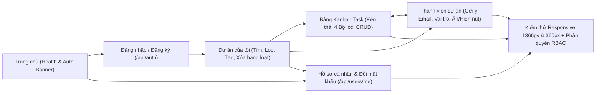

# Báo cáo Kiểm thử Chéo Toàn bộ Chức năng Hệ thống (TF154BF)

- **Mã task:** `TF154BF` — `[All] Kiểm thử toàn bộ chức năng`
- **Dự án:** Student Project Hub (Quản lý Đồ án & Bài tập nhóm Sinh viên CNTT PTIT)
- **Người thực hiện:** Lê Quang Huy (B25DTCN245)
- **Sprint:** Sprint 3 (19/11/2026 – 25/11/2026)
- **Phạm vi kiểm thử:** Kiểm thử chéo toàn bộ 7 phân hệ Frontend & Backend tích hợp trên nhánh `develop` (`9dd19b7`):
  1. Trang chủ & Health Check (`index.html`, `home.js`, `GET /api/health`)
  2. Xác thực Đăng nhập / Đăng ký (`login.html`, `login.js`, `/api/auth/*`) — *module đồng đội*
  3. Quản lý Dự án, Lọc, Phân trang & Xóa hàng loạt (`projects.html`, `projects.js`, `/api/projects/*`) — *module đồng đội*
  4. Quản lý Công việc Kanban, Kéo thả, 4 Bộ lọc & Phân quyền (`tasks.html`, `tasks.js`, `/api/tasks/*`) — *module phụ trách*
  5. Quản lý Thành viên, Tìm email gợi ý & Phân quyền vai trò (`members.html`, `members.js`, `/api/projects/{id}/members`) — *module phụ trách*
  6. Hồ sơ cá nhân & Đổi mật khẩu bảo mật (`profile.html`, `profile.js`, `/api/users/*`) — *module phụ trách*
  7. Giao diện thống nhất, Điều hướng & Responsive Desktop (1366px) / Mobile (360px) (`style.css`, `layout.js`, `custom-select.js`)

---

## 1. Sơ đồ luồng kiểm thử tích hợp toàn hệ thống

---

## 2. Tổng quan kết quả kiểm thử

| Phân hệ | Tổng Test Case | Đạt (Pass) | Lỗi phát hiện | Đã sửa (Phần mình) | Ghi nhận bảng lỗi chung (Đồng đội) |
| --- | :---: | :---: | :---: | :---: | :---: |
| 1. Trang chủ & Kết nối API | 3 | 3 | 0 | 0 | 0 |
| 2. Đăng nhập / Đăng ký (Test chéo) | 6 | 4 | 2 | 0 | 2 (`BUG-05`, `BUG-08`) |
| 3. Quản lý Dự án (Test chéo) | 6 | 4 | 2 | 0 | 2 (`BUG-06a`, `BUG-06b`) |
| 4. Bảng Kanban Task & Bộ lọc | 6 | 6 (sau sửa) | 2 | 2 (`BUG-02a`, `BUG-02b`) | 0 |
| 5. Thành viên & Phân quyền | 5 | 4 | 2 | 1 (`BUG-03`) | 1 (`BUG-07`) |
| 6. Hồ sơ cá nhân & Đổi mật khẩu | 4 | 4 (sau sửa) | 1 | 1 (`BUG-01`) | 0 |
| 7. Điều hướng, Giao diện & Responsive | 4 | 4 | 0 | 0 | 0 |
| **Tổng cộng** | **34** | **29** | **9** | **4** | **5** |

---

## 3. Bảng Test Case Kiểm thử Chéo Toàn Hệ Thống (34 Test Case)

| Mã TC | Phân hệ | Kịch bản kiểm thử | Dữ liệu / Thao tác | Kết quả mong đợi | Kết quả thực tế | Trạng thái | Ghi chú / Bug ID |
| --- | --- | --- | --- | --- | --- | :---: | --- |
| TC-01 | Trang chủ | Kiểm tra kết nối Backend | Mở `index.html`, quan sát `#health-status` và bấm `Kiểm tra lại kết nối` | Hiển thị đúng URL API từ `config.js` và trạng thái kết nối thành công / thông báo lỗi rõ ràng khi server tắt | Đúng như mong đợi | PASS | - |
| TC-02 | Trang chủ | Hiển thị banner tài khoản chưa đăng nhập | Xóa `localStorage.token`, tải lại `index.html` | Hiện thông báo chưa đăng nhập và nút `Đăng nhập ngay` trỏ tới `pages/login.html` | Đúng như mong đợi | PASS | - |
| TC-03 | Trang chủ | Hiển thị banner tài khoản đã đăng nhập | Đăng nhập thành công rồi quay về `index.html` | Hiện lời chào tên người dùng, nút `Vào Dự án của tôi` và nút `Đăng xuất` | Đúng như mong đợi | PASS | - |
| TC-04 | Auth (Chéo) | Chuyển đổi qua lại Đăng nhập / Đăng ký | Bấm `Đăng ký ngay` rồi bấm `Đăng nhập ngay` khi URL có `?redirect=...` | Giữ nguyên tham số `?redirect=...` và chỉ xóa hash `#register` | `history.replaceState(null, null, " ")` làm mất query `?redirect=...` | FAIL | `BUG-05b` |
| TC-05 | Auth (Chéo) | Validate email sai định dạng trên form Đăng nhập | Nhập `a@.b` hoặc `@.`, mật khẩu `password123`, bấm Đăng nhập | FE chặn và hiện lỗi định dạng email hợp lệ trước khi gọi API | FE chỉ check `includes("@") && includes(".")` nên cho qua, BE trả 422 | FAIL | `BUG-05a` |
| TC-06 | Auth (Chéo) | Validate mật khẩu ngắn < 8 ký tự trên form Đăng nhập | Nhập `sv@ptit.edu.vn`, mật khẩu `123456` | Hiện lỗi inline `Mật khẩu phải có tối thiểu 8 ký tự` | Đúng như mong đợi | PASS | - |
| TC-07 | Auth (Chéo) | Đăng nhập thành công & chuyển hướng Auth Guard | Truy cập `projects.html` khi chưa login → tự chuyển `login.html?redirect=...` → đăng nhập thành công | Lưu JWT `token` & `user` vào `localStorage`, tự quay về đúng trang ban đầu | Đúng như mong đợi | PASS | - |
| TC-08 | Auth (Chéo) | Đăng ký mật khẩu nhập lại không khớp | Nhập mật khẩu `Ptit@2026`, xác nhận `Ptit@2025` | Hiện lỗi inline `Mật khẩu nhập lại không khớp` | Đúng như mong đợi | PASS | - |
| TC-09 | Auth (Chéo) | Kiểm tra độ dài mật khẩu tối thiểu schema đăng ký BE | Gọi `POST /api/auth/register` với mật khẩu 6 ký tự yếu `123456` | Đồng bộ chuẩn tối thiểu 8 ký tự mạnh như FE & `ChangePasswordRequest` | Schema `UserCreate` ở BE vẫn cho phép `min_length=6` không kiểm tra độ mạnh | FAIL | `BUG-08` |
| TC-10 | Dự án (Chéo) | Tải danh sách, tìm kiếm & lọc trạng thái dự án | Nhập từ khóa tên dự án, bấm các pill `Đang thực hiện`, `Lập kế hoạch`, `Đã hoàn thành`, `Dự án của tôi` | Danh sách lọc chính xác, reset về trang 1, hiện Empty State khi không có kết quả | Đúng như mong đợi | PASS | - |
| TC-11 | Dự án (Chéo) | Sắp xếp & phân trang dự án | Đổi `sort-by` (Tên / Hạn chót), `sort-order` (Tăng / Giảm), `page-size` (6 / 10 / 20), bấm chuyển trang | Phân trang cập nhật đúng tổng số bản ghi, dropdown đồng bộ giao diện sáng | Đúng như mong đợi | PASS | - |
| TC-12 | Dự án (Chéo) | Tạo dự án mới với tên trống | Bấm `+ Tạo dự án mới`, để trống tên, bấm `Tạo dự án` | Hiện lỗi inline `Vui lòng nhập tên đề tài / dự án` | Đúng như mong đợi | PASS | - |
| TC-13 | Dự án (Chéo) | Tạo dự án có hạn chót trước ngày bắt đầu | Chọn `start-date = 2026-12-20`, `end-date = 2026-11-01`, bấm `Tạo dự án` | FE cảnh báo hạn chót không được nhỏ hơn ngày bắt đầu | FE không validate ngày bắt đầu vs hạn chót, vẫn gửi request lên BE | FAIL | `BUG-06a` |
| TC-14 | Dự án (Chéo) | Chế độ xóa nhiều dự án (Batch Delete) | Bấm `Xóa dự án`, tích chọn 2 thẻ dự án, bấm `Xóa các dự án đã chọn` → xác nhận trong modal | Mở modal liệt kê đúng tên 2 dự án, xóa thành công và cập nhật lại danh sách | Đúng như mong đợi | PASS | - |
| TC-15 | Dự án (Chéo) | Đóng modal Tạo / Xóa dự án bằng phím `Escape` | Mở `#create-modal` hoặc `#delete-modal`, nhấn phím `Escape` | Modal tự động đóng | Modal không lắng nghe phím `Escape` | FAIL | `BUG-06b` |
| TC-16 | Task Kanban | Tải chi tiết dự án đúng theo `?project_id=` | Từ `projects.html`, bấm `Xem chi tiết` trên dự án #2 (`tasks.html?project_id=2`) | Tiêu đề, mô tả, trạng thái và `owner_id` lấy theo dự án #2 từ `GET /api/projects/2` | Trước sửa: hiển thị cứng dự án #1. **Đã sửa trong TF154BF** | PASS (Fixed) | `BUG-02a` |
| TC-17 | Task Kanban | Kéo thả thẻ Task giữa 4 cột Kanban | Kéo thẻ Task từ cột `Cần làm` thả sang `Đang làm` / `Hoàn thành` | Cập nhật cột, thanh tiến độ %, gọi `PATCH /api/tasks/{id}/status` và hiện thông báo | Đúng như mong đợi | PASS | - |
| TC-18 | Task Kanban | Lọc kết hợp 4 tiêu chí & tìm theo tiêu đề | Nhập từ khóa (debounce 300ms) + chọn trạng thái + độ ưu tiên + người nhận | Gọi `GET /api/tasks` với đủ query params, hiện banner số kết quả và nút `Xóa bộ lọc` | Đúng như mong đợi | PASS | - |
| TC-19 | Task Kanban | Tạo / Sửa / Xóa Task khi đang bật bộ lọc | Bật lọc ưu tiên `HIGH`, mở chi tiết sửa tiêu đề hoặc xóa Task | Gọi `PATCH /api/tasks/{id}` / `DELETE /api/tasks/{id}`, làm mới `apiFilteredTasks` để giao diện cập nhật ngay | Trước sửa: chưa gọi `PATCH`/`DELETE` và giữ `apiFilteredTasks` cũ. **Đã sửa trong TF154BF** | PASS (Fixed) | `BUG-02b` |
| TC-20 | Task Kanban | Phân quyền đổi trạng thái dự án cho `MEMBER` / `VIEWER` | Đăng nhập tài khoản không phải Owner/Admin, mở `tasks.html` | Khóa nút `Đổi trạng thái` và select trạng thái dự án | Trước sửa: `isCurrentUserOwnerOrAdmin()` fallback `true`. **Đã sửa trong TF154BF** | PASS (Fixed) | `BUG-02a` |
| TC-21 | Task Kanban | Validate form Task & đóng modal bằng `Escape` | Để trống tiêu đề (< 3 ký tự) hoặc nhập > 255 ký tự; nhấn phím `Escape` khi mở modal | Hiện lỗi inline chính xác; phím `Escape` đóng modal gọn gàng | Đúng như mong đợi (**đã bổ sung phím Escape trong TF154BF**) | PASS | - |
| TC-22 | Thành viên | Gợi ý tìm người dùng theo email khi thêm thành viên | Gõ `ptit` vào ô email thêm thành viên, dùng phím `↑/↓/Enter` hoặc click chọn | Hiện danh sách gợi ý có highlight từ khóa, disable tài khoản đã có trong dự án | Đúng như mong đợi | PASS | - |
| TC-23 | Thành viên | Thêm thành viên với vai trò `OWNER` / `MEMBER` / `VIEWER` | Chọn vai trò `OWNER` trong dropdown và bấm `Thêm thành viên` | Gửi đúng payload `role: "owner"` khớp `ProjectMemberRole` trên Backend | Trước sửa: FE tự đổi `"owner"` thành `"admin"`. **Đã sửa trong TF154BF** | PASS (Fixed) | `BUG-03` |
| TC-24 | Thành viên | Hiển thị nhãn vai trò & ẩn nút thêm/xóa với `MEMBER` / `VIEWER` | Đăng nhập tài khoản `MEMBER` / `VIEWER` (hoặc chọn `Xem thử quyền: MEMBER`) | Hiện nhãn vai trò ở đầu trang & trong bảng, ẩn hoàn toàn form thêm, cột Thao tác và nút xóa | Đúng như mong đợi | PASS | - |
| TC-25 | Thành viên | Chống xóa Chủ dự án cuối cùng | Đăng nhập `OWNER`, kiểm tra dòng Chủ dự án | Hiện chữ `Chủ dự án`, không hiển thị nút `Xóa khỏi dự án` | Đúng như mong đợi | PASS | - |
| TC-26 | Thành viên (BE Chéo) | Admin hệ thống gọi `POST /api/projects/{id}/members` | Đăng nhập tài khoản `UserRole.ADMIN` (không phải `owner_id`), gọi API thêm thành viên | Cho phép Admin hệ thống thêm thành viên (đồng nhất với API xóa & đổi vai trò ở PR #60) | `add_project_member_by_email` chỉ check `project.owner_id != current_user_id` nên trả 403 | FAIL | `BUG-07` |
| TC-27 | Hồ sơ cá nhân | Cập nhật họ tên, email, avatar URL, bio | Sửa họ tên, bio và bấm `Lưu thay đổi` | Gọi `PUT /api/users/me`, cập nhật thẻ tóm tắt bên trái và tên trên Header ngay lập tức | Đúng như mong đợi | PASS | - |
| TC-28 | Hồ sơ cá nhân | Validate mật khẩu mới yếu trên form Đổi mật khẩu | Nhập mật khẩu cũ hợp lệ, mật khẩu mới `123456` hoặc `password123` (thiếu chữ hoa / ký tự đặc biệt) | FE chặn ngay trước khi gọi API và giải thích rõ chuẩn 8+ ký tự gồm hoa, thường, số, ký tự đặc biệt | Trước sửa: FE chỉ yêu cầu >= 6 ký tự nên gửi lên BE bị 422. **Đã sửa trong TF154BF** | PASS (Fixed) | `BUG-01` |
| TC-29 | Hồ sơ cá nhân | Đổi mật khẩu hợp lệ (`Ptit@2026`) | Nhập mật khẩu cũ đúng, mật khẩu mới `Ptit@2026`, xác nhận `Ptit@2026` | Thanh đo hiện `Mạnh (đạt chuẩn bảo mật)`, gọi `POST /api/users/change-password` thành công và reset form | Đúng như mong đợi | PASS | - |
| TC-30 | Hồ sơ cá nhân | Nút `Hiện / Ẩn` mật khẩu & nút `Khôi phục` | Bấm `Hiện` trên 3 ô mật khẩu; sửa họ tên rồi bấm `Khôi phục` | Đổi `type="text"/"password"` đúng từng ô; nút Khôi phục trả lại giá trị trước khi sửa | Đúng như mong đợi | PASS | - |
| TC-31 | Điều hướng & UI | Đồng nhất Header tối giản & liên kết ngữ cảnh `project_id` | Chuyển qua lại giữa `index.html`, `projects.html`, `tasks.html?project_id=2`, `members.html?project_id=2`, `profile.html` | Header giữ nguyên vị trí, trạng thái active chuẩn, bấm chip tên tài khoản sang `profile.html` | Đúng như mong đợi | PASS | - |
| TC-32 | Responsive | Kiểm tra hiển thị trên màn hình Mobile 360px | Thu nhỏ viewport về `360x800` trên cả 6 trang | Nút hamburger mở/đóng menu gọn gàng, không vỡ layout, không tràn ngang | Đúng như mong đợi | PASS | - |
| TC-33 | Responsive | Dropdown `custom-select.js` trong Modal & Toolbar | Mở toàn bộ dropdown trên `projects.html`, `tasks.html`, `members.html` | Giao diện nền sáng đồng nhất, không bị cắt trong modal, không dính theme tối macOS | Đúng như mong đợi | PASS | - |
| TC-34 | Cross-Check | Kiểm tra chéo DOM IDs, đường dẫn tương đối & cú pháp JS/CSS | Chạy script kiểm tra tự động toàn bộ 6 trang HTML và 7 file JS | 0 DOM ID thiếu, 0 đường dẫn asset/link hỏng, 0 lỗi cú pháp | Đúng như mong đợi | PASS | - |

---

## 4. Bảng Ghi Nhận Lỗi Chung (Shared Bug Log)

| Mã lỗi | Module / File | Mức độ | Bước tái hiện | Kết quả thực tế | Kết quả mong đợi | Phụ trách | Trạng thái |
| --- | --- | :---: | --- | --- | --- | --- | :---: |
| **BUG-01** | Hồ sơ & Đổi mật khẩu (`frontend/pages/profile.html`, `frontend/js/pages/profile.js`) | **High** | 1. Mở `pages/profile.html` 2. Nhập mật khẩu cũ bất kỳ 3. Nhập mật khẩu mới `123456` hoặc `abc12345`, xác nhận giống hệt 4. Bấm `Cập nhật mật khẩu` | FE báo hợp lệ và gửi request lên `POST /api/users/change-password`, sau đó BE trả HTTP 422 (`Mật khẩu mới quá yếu`). Mô tả UI cũng ghi sai là `tối thiểu 6 ký tự`. | FE validate đồng bộ với `backend/app/core/security.py`: tối thiểu 8 ký tự, gồm chữ hoa, chữ thường, chữ số và ký tự đặc biệt. | Lê Quang Huy | **Đã sửa (TF154BF)** |
| **BUG-02a** | Bảng Kanban Task (`frontend/js/pages/tasks.js`) | **High** | 1. Đăng nhập tài khoản `MEMBER` / `VIEWER` 2. Mở `pages/tasks.html?project_id=2` 3. Quan sát tiêu đề dự án và khu vực đổi trạng thái dự án | Tiêu đề luôn hiển thị cứng `Dự án: Student Project Hub` (chưa gọi `GET /api/projects/{id}`), đồng thời nút `Đổi trạng thái` vẫn bật do `isCurrentUserOwnerOrAdmin()` trả về `true` mặc định. | Tải chi tiết dự án theo `project_id` từ API để lấy `name`, `description`, `owner_id`, `status`; khóa nút đổi trạng thái với tài khoản không phải Owner/Admin. | Lê Quang Huy | **Đã sửa (TF154BF)** |
| **BUG-02b** | Bảng Kanban Task (`frontend/js/pages/tasks.js`) | **Medium** | 1. Mở `pages/tasks.html`, lọc Task theo độ ưu tiên `HIGH` (gọi API `GET /api/tasks`) 2. Mở chi tiết sửa tiêu đề Task hoặc bấm `Xóa Task` | Form sửa/xóa không gọi `PATCH /api/tasks/{id}` / `DELETE /api/tasks/{id}` và không làm mới biến `apiFilteredTasks`, khiến giao diện vẫn hiển thị dữ liệu lọc cũ. | Gọi API `PATCH`/`DELETE` tương ứng khi backend bật và reset `apiFilteredTasks = null` sau mọi thao tác tạo/sửa/kéo thả/xóa Task. | Lê Quang Huy | **Đã sửa (TF154BF)** |
| **BUG-03** | Thành viên dự án (`frontend/js/pages/members.js`) | **Medium** | 1. Mở `pages/members.html` với quyền Owner 2. Nhập email hợp lệ, chọn vai trò `OWNER`, bấm `Thêm thành viên` 3. Quan sát payload gửi tới `POST /api/projects/{id}/members` | FE tự động ánh xạ `selectedRole === "owner"` thành `role: "admin"`, trong khi Backend PR #60 (`TF16158`) đã chuẩn hóa 3 vai trò dự án là `owner`, `member`, `viewer`. Đồng thời hiển thị tên dự án chỉ đọc `projectData.title` mà chưa fallback `projectData.name`. | Gửi đúng `role: "owner"` (hoặc `member`, `viewer`) và đọc `projectData.name \|\| projectData.title`. | Lê Quang Huy | **Đã sửa (TF154BF)** |
| **BUG-05a** | Xác thực (`frontend/js/pages/login.js`) | **Medium** | 1. Mở `pages/login.html` 2. Nhập email `a@.b` hoặc `@.`, mật khẩu `password123` 3. Bấm `Đăng nhập` hoặc chuyển sang `Đăng ký` và bấm `Đăng ký tài khoản` | Validation FE chỉ kiểm tra `email.includes("@") && email.includes(".")` nên cho gửi request lên API, nhận lỗi HTTP 422 từ Pydantic `EmailStr`. | Kiểm tra định dạng email bằng regex chuẩn `/^[^\s@]+@[^\s@]+\.[^\s@]+$/` trước khi gọi API. | Nhóm Auth (Đồng đội) | **Mở (Đã ghi nhận)** |
| **BUG-05b** | Xác thực (`frontend/js/pages/login.js`) | **Low** | 1. Khi chưa đăng nhập, truy cập `pages/projects.html` → tự chuyển tới `login.html?redirect=...` 2. Bấm `Đăng ký ngay` (thêm `#register`), sau đó bấm `Đăng nhập ngay` | `switchToLogin()` gọi `history.replaceState(null, null, " ")` làm mất tham số `?redirect=...`, nên sau khi đăng nhập không quay lại đúng trang cũ. | Chỉ xóa hash: `history.replaceState(null, null, window.location.pathname + window.location.search)`. | Nhóm Auth (Đồng đội) | **Mở (Đã ghi nhận)** |
| **BUG-06a** | Quản lý Dự án (`frontend/js/pages/projects.js`) | **Medium** | 1. Mở `pages/projects.html`, bấm `+ Tạo dự án mới` 2. Nhập tên hợp lệ, chọn `Ngày bắt đầu = 2026-12-20`, `Hạn chót = 2026-11-01` 3. Bấm `Tạo dự án` | FE không kiểm tra điều kiện `deadline < start_date`, vẫn gửi payload ngày ngược lên API. | Kiểm tra `if (startDate && deadline && deadline < startDate)` và hiển thị lỗi inline rõ ràng. | Nhóm Projects (Đồng đội) | **Mở (Đã ghi nhận)** |
| **BUG-06b** | Quản lý Dự án (`frontend/js/pages/projects.js`) | **Low** | 1. Mở modal Tạo dự án (`#create-modal`) hoặc modal Xóa dự án (`#delete-modal`) 2. Nhấn phím `Escape` trên bàn phím | Modal không đóng (khác với trải nghiệm trên trang `tasks.html` và `members.html`). | Bổ sung listener `keydown` bắt phím `Escape` để đóng modal đang mở. | Nhóm Projects (Đồng đội) | **Mở (Đã ghi nhận)** |
| **BUG-07** | Thành viên BE (`backend/app/crud/project_members.py`) | **Low** | 1. Đăng nhập tài khoản Admin hệ thống (`role = ADMIN`, không phải `owner_id` dự án) 2. Gọi `POST /api/projects/{id}/members` thêm thành viên | Trả về HTTP 403 (`Chỉ chủ dự án mới có quyền thêm thành viên`), không nhất quán với `DELETE`/`PATCH` ở PR #60 (cho phép cả Owner và System Admin). | Bổ sung kiểm tra `is_system_admin` tương tự `remove_project_member` và `update_project_member_role`. | Nhóm BE Members (Đồng đội) | **Mở (Đã ghi nhận)** |
| **BUG-08** | Schema Đăng ký BE (`backend/app/schemas/users.py`) | **Low** | 1. Gọi `POST /api/auth/register` với `password: "123456"` | `UserCreate` chấp nhận mật khẩu 6 ký tự yếu, chưa thống nhất với form đăng ký FE (`>= 8` ký tự) và `ChangePasswordRequest` (`get_password_strength_error`). | Đồng bộ quy tắc kiểm tra độ mạnh mật khẩu giữa đăng ký mới và đổi mật khẩu. | Nhóm BE Users/Auth (Đồng đội) | **Mở (Đã ghi nhận)** |

---

## 5. Danh sách file đã sửa lỗi thuộc phần phụ trách (Lê Quang Huy)

- [frontend/pages/profile.html](file:///Users/huy/Desktop/PTIT/Thực Tập/frontend/pages/profile.html): Cập nhật mô tả & placeholder chuẩn mật khẩu mạnh (tối thiểu 8 ký tự, chữ hoa, chữ thường, chữ số, ký tự đặc biệt).
- [frontend/js/pages/profile.js](file:///Users/huy/Desktop/PTIT/Thực Tập/frontend/js/pages/profile.js): Bổ sung `getPasswordStrengthError()` khớp 100% logic Backend `security.py` và cập nhật thanh đo độ mạnh mật khẩu.
- [frontend/js/pages/tasks.js](file:///Users/huy/Desktop/PTIT/Thực Tập/frontend/js/pages/tasks.js): Bổ sung `syncProjectDetails()` (`GET /api/projects/{id}`), siết chặt `isCurrentUserOwnerOrAdmin()`, nối `PATCH /api/tasks/{id}` & `DELETE /api/tasks/{id}`, reset `apiFilteredTasks` sau thao tác dữ liệu và hỗ trợ phím `Escape` đóng modal.
- [frontend/js/pages/members.js](file:///Users/huy/Desktop/PTIT/Thực Tập/frontend/js/pages/members.js): Gửi đúng `role: "owner"` (không chuyển thành `"admin"`) khớp Backend PR #60 và hỗ trợ `projectData.name || projectData.title`.
