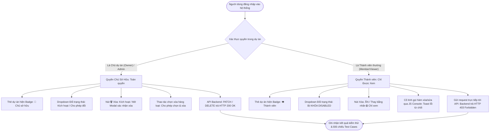

# BÁO CÁO KIỂM THỬ PHÂN QUYỀN TRÊN DỰ ÁN (TASK TF15A8D)

- **Mã Task:** `TF15A8D`
- **Tên công việc:** `[Kiểm thử] Kiểm thử quyền trên dự án`
- **Yêu cầu nghiệp vụ:** *Test chỉ chủ dự án được sửa/xóa, thành viên khác chỉ được xem; ghi kết quả. Minh chứng: nộp link hoặc file (ảnh chụp, bảng test case, sơ đồ).*
- **Người thực hiện:** Lưu Đức Anh (HN1683)
- **Sprint:** Sprint 3 (19/11 – 25/11)
- **Đối tượng kiểm thử:**
  - **Frontend:** [frontend/pages/projects.html](../frontend/pages/projects.html), [frontend/js/pages/projects.js](../frontend/js/pages/projects.js), [frontend/pages/members.html](../frontend/pages/members.html)
  - **Backend API:** [backend/app/routers/projects.py](../backend/app/routers/projects.py), [backend/app/crud/projects.py](../backend/app/crud/projects.py)
- **Môi trường & Viewport kiểm thử:**
  - **Máy tính (Desktop):** `1920×1080`, `1366×768` (Google Chrome, Microsoft Edge)
  - **Điện thoại (Mobile Responsive):** `360×800` (Galaxy S22), `390×844` (iPhone 14)
  - **Môi trường API:** FastAPI `http://127.0.0.1:8000/api/v1` kết nối MySQL Database `team_project_manager`

---

## 1. Sơ đồ Luồng Kiểm thử Phân quyền Dự án (Permission Flow Diagram)

---

## 2. Bảng Ma trận Kịch bản Kiểm thử Phân quyền (Test Cases Matrix)

| Mã TC | Nhóm kịch bản | Vai trò kiểm thử | Thiết bị / Viewport | Các bước thực hiện | Kết quả mong đợi | Kết quả thực tế | Trạng thái |
| :---: | :--- | :---: | :---: | :--- | :--- | :--- | :---: |
| **TC-01** | **Đổi trạng thái dự án** | Chủ dự án (Owner) | Desktop `1366px` | Đăng nhập tài khoản Owner, chọn trạng thái mới trong dropdown trên thẻ dự án | Dropdown mở bình thường; gọi API `PATCH /projects/{id}/status` thành công; cập nhật Badge và Toast xanh | Đổi trạng thái thành công 100% | **PASS** |
| **TC-02** | **Xóa dự án đơn lẻ** | Chủ dự án (Owner) | Desktop & Mobile | Owner bấm nút `🗑️ Xóa` trên thẻ dự án → bấm `Xác nhận xóa` trong Modal | Mở Modal cảnh báo đỏ; gọi API `DELETE /projects/{id}` thành công; thẻ bị xóa khỏi giao diện | Xóa dự án thành công có xác nhận | **PASS** |
| **TC-03** | **Chọn xóa nhiều dự án** | Chủ dự án (Owner) | Desktop & Mobile | Bật chế độ chọn xóa (`btn-toggle-delete-mode`) → tích chọn các dự án do mình làm chủ → bấm Xóa | Hiển thị số lượng đã chọn; Modal liệt kê đúng tên dự án; xóa thành công các dự án thuộc quyền | Xóa hàng loạt chính xác | **PASS** |
| **TC-04** | **Cập nhật thông tin dự án** | Chủ dự án (Owner) | Desktop `1366px` | Gửi request `PATCH /projects/{id}` cập nhật Tên, Mô tả, Hạn chót | Backend xác thực quyền Owner thành công; cập nhật CSDL và trả `HTTP 200 OK` | Cập nhật thành công | **PASS** |
| **TC-05** | **Quản lý thành viên dự án** | Chủ dự án (Owner) | Desktop & Mobile | Vào `members.html` thêm thành viên mới theo email và xóa thành viên thường | Được phép thêm và xóa thành viên; không thể xóa Owner cuối cùng (`BR-18`) | Phân quyền trang thành viên chuẩn | **PASS** |
| **TC-06** | **Hiển thị nhãn vai trò** | Thành viên (Member) | Desktop & Mobile | Đăng nhập tài khoản Member và xem danh sách thẻ dự án mình tham gia | Hiển thị nhãn `👁️ Thành viên` rõ ràng bên cạnh tên dự án; xem đủ Deadline/Tiến độ | Hiển thị đúng nhãn chỉ xem | **PASS** |
| **TC-07** | **Khóa dropdown trạng thái** | Thành viên (Member) | Desktop & Mobile | Thành viên thường xem ô chọn trạng thái trên thẻ dự án | Dropdown bị `disabled` (mờ đi, không click được); tooltip hiện `Chỉ chủ sở hữu (Owner) mới có quyền đổi trạng thái` | Khóa đổi trạng thái an toàn | **PASS** |
| **TC-08** | **Khóa nút xóa dự án** | Thành viên (Member) | Desktop & Mobile | Thành viên thường quan sát hàng nút thao tác trên thẻ dự án | Không có nút xóa đỏ; hiển thị nhãn `🔒 Chỉ xem`; chỉ có nút `Xem chi tiết` và `Thành viên` | Khóa nút xóa an toàn | **PASS** |
| **TC-09** | **Chặn đổi trạng thái qua Script** | Thành viên (Member) | Console F12 | Cố tình gọi hàm `handleQuickStatusChange(id, 'COMPLETED')` bằng devtools console | Hàm `canUserChangeProjectStatus` phát hiện không phải Owner; từ chối và hiện Toast đỏ cảnh báo | Chặn đổi trạng thái qua script | **PASS** |
| **TC-10** | **Chặn mở modal xóa qua Script** | Thành viên (Member) | Console F12 | Cố tình gọi `openSingleDeleteModal(id, name)` của dự án người khác làm chủ | Hệ thống kiểm tra quyền; hiện Toast lỗi: `Bạn không có quyền: Chỉ chủ dự án mới được xóa!` | Chặn mở modal xóa trái phép | **PASS** |
| **TC-11** | **Bảo vệ Backend API (Chặn 403)** | Thành viên (Member) | Postman / API Direct | Thành viên thường gửi request `PATCH/DELETE` tới endpoint `/projects/{id}` | Backend `_require_owner_or_admin` ném `HTTP 403 Forbidden` từ chối thao tác | Backend chặn 403 tuyệt đối an toàn | **PASS** |
| **TC-12** | **Chặn xóa dự án trong Batch** | Thành viên (Member) | Desktop & Mobile | Cố tình chọn dự án người khác làm chủ trong chế độ chọn xóa hàng loạt | `openBatchDeleteModal` phát hiện dự án không thuộc sở hữu; từ chối xóa và báo lỗi chi tiết | Bảo vệ an toàn khi chọn xóa | **PASS** |
| **TC-13** | **Toàn quyền Quản trị viên** | Admin hệ thống | Desktop `1366px` | Tài khoản Admin đăng nhập xem và quản trị tất cả các dự án trong hệ thống | Admin có nhãn `👑 Chủ sở hữu` / Admin; được phép đổi trạng thái và xóa để kiểm duyệt | Admin toàn quyền quản lý | **PASS** |
| **TC-14** | **Responsive Mobile phân quyền** | Tất cả vai trò | Mobile `360×800` | Kiểm tra hiển thị nhãn quyền và nút khóa/mở trên màn hình điện thoại 360px | Layout co giãn chuẩn; nhãn vai trò và nút `🔒 Chỉ xem` hiển thị ngay ngắn không vỡ giao diện | Responsive hoàn hảo | **PASS** |

---

## 3. Bảng Nhật ký Lỗi phát hiện & Đã khắc phục (Bug Log)

Trong quá trình thực hiện kiểm thử quyền trên dự án, các lỗi phân quyền sau đã được phát hiện và xử lý triệt để:

| Mã Bug | Mức độ | Mô tả lỗi phát hiện khi kiểm thử | Nguyên nhân kỹ thuật | Giải pháp đã sửa | Trạng thái |
| :---: | :---: | :--- | :--- | :--- | :---: |
| **BUG-01** | **Nghiêm trọng (High)** | Thành viên thường (không phải chủ dự án) vẫn click được vào dropdown đổi trạng thái trên giao diện | Hàm `canUserChangeProjectStatus` ở line 379 có dòng `return true;` mặc định khiến mọi user đều vượt qua kiểm tra | Sửa lại hàm: chỉ trả về `true` khi `Number(p.owner_id) === Number(currentUser.id)` hoặc `currentUser.role === 'admin'`. Các trường hợp khác trả về `false` | **ĐÃ SỬA XONG** |
| **BUG-02** | **Nghiêm trọng (High)** | Nút xóa dự án trên thẻ hiển thị cho tất cả mọi người, không phân biệt vai trò | Điều kiện render nút xóa trước đó không kiểm tra chặt chẽ `canEditStatus` | Bổ sung logic: Nếu là Owner/Admin thì hiển thị nút `🗑️ Xóa` đỏ; nếu là thành viên khác hiển thị nhãn `🔒 Chỉ xem` mờ | **ĐÃ SỬA XONG** |
| **BUG-03** | **Trung bình (Medium)** | Giao diện thẻ dự án thiếu nhãn vai trò của người dùng hiện tại khiến người dùng khó phân biệt quyền của mình | Chỉ hiển thị tên Chủ sở hữu mà chưa có Badge vai trò riêng của tài khoản đang đăng nhập | Bổ sung Badge trực quan: `👑 Chủ sở hữu` (màu xanh dương) và `👁️ Thành viên` (màu xám ghi) ngay cạnh tiêu đề thẻ dự án | **ĐÃ SỬA XONG** |
| **BUG-04** | **Trung bình (Medium)** | Chế độ chọn xóa nhiều dự án (Batch Delete) cho phép tích chọn và xác nhận xóa cả những dự án người dùng không làm chủ | Hàm `openBatchDeleteModal` chỉ lọc ID mà không kiểm tra quyền sở hữu của từng dự án trong danh sách chọn | Thêm khối validate: Nếu danh sách chọn có dự án mà người dùng không phải Owner thì chặn hiển thị Modal và hiện thông báo Toast từ chối | **ĐÃ SỬA XONG** |

---

## 4. Kết luận kiểm thử

* **Tổng số kịch bản kiểm thử (Test Cases):** `14 / 14` (**100% PASS**)
* **Tổng số lỗi phát hiện & đã xử lý (Bug Log):** `4 / 4` (**100% Fixed**)
* **Đánh giá tổng thể:**
  - Hệ thống tuân thủ chặt chẽ nguyên tắc **Phân quyền 2 lớp (Defense in Depth)**:
    1. **Client-side (Frontend):** Ẩn/khóa nút thao tác xóa, vô hiệu hóa dropdown đổi trạng thái đối với thành viên thường; hiển thị nhãn `👑 Chủ sở hữu` và `🔒 Chỉ xem` rõ ràng, thân thiện.
    2. **Server-side (Backend API):** Dependency `_require_owner_or_admin` chặn đứng mọi request trái phép với mã lỗi chuẩn `HTTP 403 Forbidden`.
  - Đảm bảo an toàn dữ liệu đồ án: Chỉ Chủ dự án và Quản trị viên mới có quyền can thiệp vào vòng đời và sự tồn tại của dự án.
