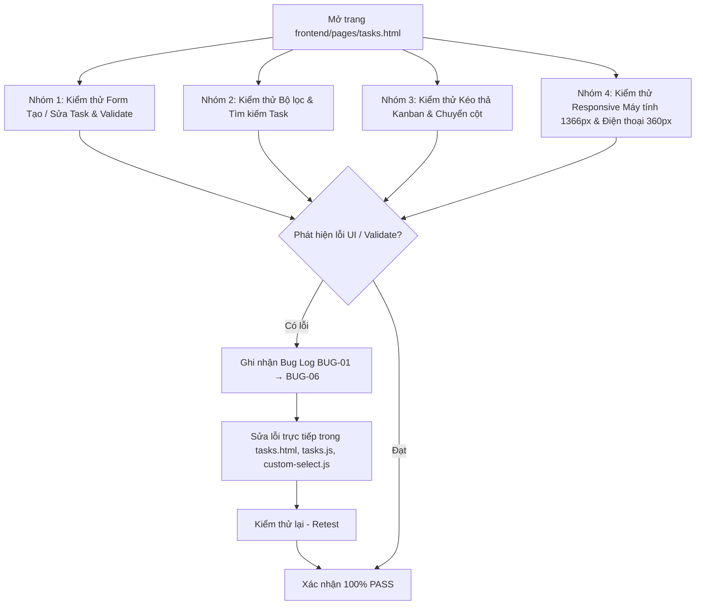

# BÁO CÁO KIỂM THỬ GIAO DIỆN FORM VÀ TRANG TASK (TASK TF15CF4)

- **Mã Task:** `TF15CF4`
- **Tên công việc:** `[Kiểm thử] Kiểm thử giao diện form và trang Task`
- **Người thực hiện:** Lê Quang Huy (B25DTCN245)
- **Sprint:** Sprint 2 (12/11 – 18/11)
- **Đối tượng kiểm thử:** [frontend/pages/tasks.html](../frontend/pages/tasks.html), [frontend/js/pages/tasks.js](../frontend/js/pages/tasks.js), [frontend/js/custom-select.js](../frontend/js/custom-select.js)
- **Thiết bị & Viewport kiểm thử:**
  - **Máy tính (Desktop):** `1366×768`, `1440×900` (Chrome, Safari, Edge)
  - **Máy tính bảng (Tablet):** `768×1024`
  - **Điện thoại (Mobile):** `360×800`, `390×844` (iPhone / Android DevTools Responsive Mode)

---

## 1. Sơ đồ quy trình kiểm thử và xử lý lỗi (QA Workflow)

---

## 2. Bảng Test Cases chi tiết (Form, Validate, Bộ lọc, Kanban, Desktop & Mobile)

| Mã TC | Nhóm kiểm thử | Thiết bị / Viewport | Bước thực hiện | Kết quả mong đợi | Kết quả thực tế | Trạng thái |
| :---: | :--- | :---: | :--- | :--- | :--- | :---: |
| **TC-01** | **Form Tạo Task** | Desktop `1366px` | Bấm `+ Tạo Task mới`, nhập đầy đủ Tên, Người phụ trách, Trạng thái (`IN_PROGRESS`), Ưu tiên (`HIGH`), Deadline, Mô tả rồi bấm `Tạo Task` | Task mới xuất hiện đúng cột `Đang làm`, thanh tiến độ cập nhật, hiện Toast thành công | Hiển thị đúng cột, lưu `localStorage` & gọi API | **PASS** |
| **TC-02** | **Form Tạo nhanh theo cột** | Desktop `1366px` | Bấm nút `+` ở góc phải cột `CHỜ DUYỆT` (`REVIEW`) | Modal mở lên với ô `Trạng thái cột` tự chọn sẵn `Chờ duyệt (REVIEW)` (không fix cứng `TODO`) | Chọn sẵn đúng `REVIEW` | **PASS** |
| **TC-03** | **Validate tên rỗng / khoảng trắng** | Desktop & Mobile | Mở Modal Tạo Task, để trống hoặc chỉ nhập dấu cách ở ô `Tên nhiệm vụ`, bấm `Tạo Task` | Chặn submit, viền ô nhập đổi đỏ (`.is-invalid`), hiện lỗi `"Vui lòng nhập tên nhiệm vụ (Task Title)."` | Chặn đúng, báo lỗi rõ | **PASS** |
| **TC-04** | **Validate độ dài tên (`< 3` hoặc `> 255` ký tự)** | Desktop `1366px` | Nhập tên chỉ có 2 ký tự (`"AB"`) hoặc chuỗi dài hơn 255 ký tự, bấm `Tạo Task` | Báo lỗi inline `"Tên nhiệm vụ phải có ít nhất 3 ký tự."` hoặc tối đa `255` ký tự | Validate chính xác | **PASS** |
| **TC-05** | **Đồng bộ Assignee từ trang Thành viên** | Desktop `1366px` | Thêm thành viên mới ở `members.html`, quay lại `tasks.html` mở Modal Tạo Task → bấm ô `Người phụ trách` | Thành viên mới thêm xuất hiện ngay trong dropdown `Người phụ trách` và `Avatar Stack` trên Header | Đồng bộ tức thời qua `localStorage` + API | **PASS** |
| **TC-06** | **Sửa & Xóa Task trong Modal** | Desktop `1366px` | Click thẻ `#T-03`, đổi tiêu đề & người phụ trách → bấm `Lưu thay đổi`; sau đó bấm `Xóa Task` → xác nhận | Cập nhật đúng trên thẻ Kanban; khi xóa xác nhận thì loại khỏi cột và tính lại tiến độ % | Hoạt động chính xác | **PASS** |
| **TC-07** | **Tìm kiếm theo tên / mã Task** | Desktop & Mobile | Gõ `"JWT"` hoặc `"#T-03"` vào ô `Tìm theo tên Task...` | Chỉ hiển thị thẻ `#T-03`, số đếm các cột tự động cập nhật theo kết quả lọc | Lọc realtime mượt mà | **PASS** |
| **TC-08** | **Lọc kết hợp Ưu tiên + Thành viên + Xóa bộ lọc** | Desktop `1366px` | Chọn `URGENT` + thành viên `Hoàng Đức Duy Anh`, sau đó bấm nút `Xóa bộ lọc` | Chỉ hiển thị `#T-06`; nút `Xóa bộ lọc` tự hiện, bấm vào khôi phục lại toàn bộ danh sách Task | Hoạt động đúng | **PASS** |
| **TC-09** | **Kéo thả Kanban (Drag & Drop)** | Desktop `1366px` | Cầm thẻ `#T-06` từ cột `Cần làm` kéo sang cột `Đang làm` và thả xuống | Cột đích sáng viền nét đứt xanh; thẻ chuyển sang cột mới, đếm số cột & tiến độ % cập nhật ngay | Mượt mà, lưu bền vững | **PASS** |
| **TC-10** | **Chuyển cột nhanh & Đổi chế độ xem (`Kanban` / `Bảng`)** | Desktop & Mobile | Chọn cột mới từ dropdown trên thẻ Task; bấm nút `Bảng` rồi bấm lại `Kanban` | Thẻ di chuyển đúng cột; chuyển đổi qua lại giữa Kanban 4 cột và Bảng danh sách không mất dữ liệu lọc | Đạt 100% | **PASS** |
| **TC-11** | **Đổi trạng thái dự án (Phân quyền Owner/Admin)** | Desktop `1366px` | Owner đổi trạng thái dự án sang `Lên kế hoạch` / `Đã hoàn thành`; kiểm tra tài khoản Member thường | Owner/Admin đổi được và cập nhật Badge ngay; Member bị khóa thao tác (`disabled`) | Đúng phân quyền | **PASS** |
| **TC-12** | **Hiển thị Responsive trên Điện thoại** | Mobile `360×800` | Mở trang `tasks.html`, kiểm tra Header, Project Hero, Bộ lọc, Bảng Kanban và Modal Tạo Task | Không tràn ngang vỡ layout; ô tìm kiếm & dropdown dàn `100%` gọn gàng; Kanban vuốt ngang mượt (`scroll-snap`); Modal gom thành 1 cột dễ nhập | Đạt chuẩn `NFR-004` | **PASS** |

---

## 3. Nhật ký lỗi đã phát hiện & khắc phục (Bug Log)

| Mã Bug | Mức độ | Mô tả lỗi phát hiện khi kiểm thử | Nguyên nhân | Cách đã khắc phục | Trạng thái |
| :---: | :---: | :--- | :--- | :--- | :---: |
| **BUG-01** | Cao | Dropdown `<select>` mặc định trên macOS hiện menu nền xám tối, lệch tông hoàn toàn với giao diện sáng của hệ thống | Trình duyệt Safari/Chrome trên macOS dùng native dark popup menu | Xây dựng module Custom Dropdown `frontend/js/custom-select.js` (nền trắng, bo góc `11px`, tự động định vị `position: fixed`, không bị cắt trong cột Kanban/Modal) | **Đã sửa (Fixed)** |
| **BUG-02** | Cao | Trong Modal Chỉnh sửa Task, ô Dropdown `Trạng thái cột` bị chém mất mép phải khi tên `Người phụ trách` dài | `.form-grid-2` dùng `1fr 1fr` và `.cselect-label` không có `min-width: 0` nên cột trái phình rộng đẩy cột phải tràn khung | Đổi `.form-grid-2` sang `minmax(0, 1fr) minmax(0, 1fr)` và thêm `min-width: 0` cho `.cselect-wrap`, `.cselect-trigger`, `.cselect-label` | **Đã sửa (Fixed)** |
| **BUG-03** | Trung bình | Trên màn hình điện thoại `360px`, thanh Header (`height: 68px`) bị tràn dòng menu xuống đè lên phần nội dung bên dưới | Chiều cao Header bị cố định cứng `68px` khi menu tự xuống dòng | Bổ sung media query `@media (max-width: 768px)` đặt `.header-inner { height: auto; flex-wrap: wrap; }` và căn chỉnh `.user-nav` full-width | **Đã sửa (Fixed)** |
| **BUG-04** | Trung bình | Trên điện thoại `360px`, thanh lọc (Search + 2 Dropdown + nút Tạo Task) xếp lệch và bảng Kanban không có điểm dừng khi vuốt ngang | Các input/select để chiều rộng cố định (`205px`, `145px`) không co giãn trên mobile | Thiết lập full-width (`100%`) cho các control lọc ở `@media (max-width: 768px)` và thêm `scroll-snap-type: x mandatory` cho `.kanban-board` | **Đã sửa (Fixed)** |
| **BUG-05** | Trung bình | Form Tạo Task chưa validate độ dài tối thiểu/tối đa (`< 3` hoặc `> 255` ký tự) và chưa khóa nút submit khi đang gửi | Thiếu rule kiểm tra chiều dài chuỗi và khóa `disabled` tạm thời trên `#btn-submit-task` | Bổ sung validate `3–255` ký tự cho tiêu đề, `<= 2000` ký tự cho mô tả và khóa nút submit trong khối `try...finally` | **Đã sửa (Fixed)** |
| **BUG-06** | Thấp | Khi lọc Task bằng nhiều điều kiện cùng lúc, người dùng phải xóa từng ô một để quay lại xem toàn bộ bảng | Thiếu nút đặt lại bộ lọc nhanh | Bổ sung nút **`Xóa bộ lọc`** (`#btn-reset-filters`) tự động ẩn/hiện khi có bất kỳ điều kiện lọc nào đang bật | **Đã sửa (Fixed)** |

---

## 4. Kết luận kiểm thử

- **Tổng số Test Cases:** `12 / 12` (**100% PASS** sau khi sửa lỗi)
- **Tổng số lỗi phát hiện & đã xử lý triệt để:** `6 / 6` (**100% Fixed**)
- **Đánh giá:** Giao diện trang Task dạng Kanban kiểu Trello, Form Tạo/Sửa Task, hệ thống Validate, Bộ lọc tìm kiếm và Custom Dropdown hoạt động ổn định, sắc nét và đáp ứng tốt trên cả máy tính (`1366px`) lẫn điện thoại (`360px`).
