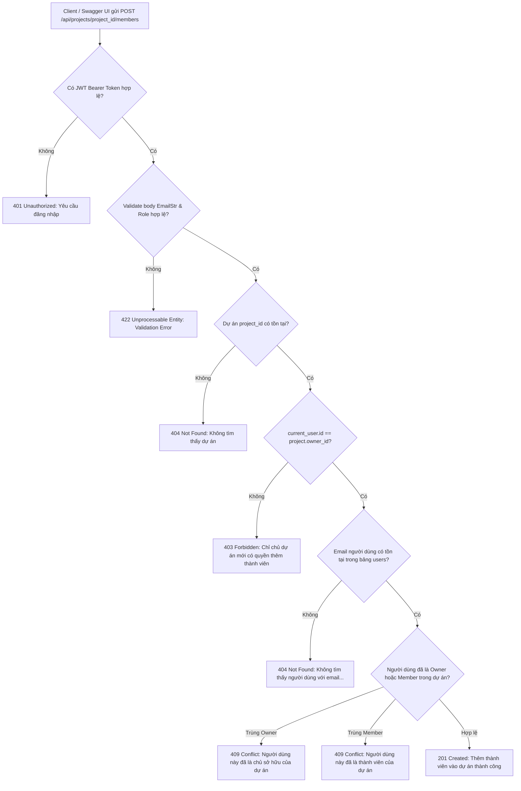

# BÁO CÁO KIỂM THỬ API THÊM THÀNH VIÊN DỰ ÁN BẰNG SWAGGER (TASK TF15F4C)

- **Mã Task:** `TF15F4C`
- **Tên công việc:** `[Kiểm thử] Test API thêm thành viên bằng Swagger`
- **Người thực hiện:** Lê Quang Huy (B25DTCN245)
- **Sprint:** Sprint 2 (12/11 – 18/11)
- **Endpoint kiểm thử:** `POST /api/projects/{project_id}/members`
- **Công cụ kiểm thử:** FastAPI Swagger UI (`http://127.0.0.1:8000/docs`)

---

## 1. Sơ đồ luồng xử lý và kiểm thử API (`POST /api/projects/{project_id}/members`)



---

## 2. Dữ liệu chuẩn bị trước khi kiểm thử (Pre-conditions)

| Đối tượng | Thông tin dữ liệu mẫu trong DB | Vai trò thực tế |
| :--- | :--- | :--- |
| **User 1 (Owner)** | `id = 1`, `email = "truongnhom1@example.com"`, `full_name = "Lê Quang Huy"` | Chủ sở hữu dự án `project_id = 1` |
| **User 2 (Member 1)** | `id = 2`, `email = "duc.nm@ptit.edu.vn"`, `full_name = "Nguyễn Minh Đức"` | Tài khoản sinh viên hợp lệ chưa vào dự án |
| **User 3 (Member 2)** | `id = 3`, `email = "anh.ld@ptit.edu.vn"`, `full_name = "Lưu Đức Anh"` | Tài khoản dùng để test quyền không phải Owner |
| **Project 1** | `id = 1`, `name = "Student Project Hub"`, `owner_id = 1` | Dự án đang hoạt động (`in_progress`) |

---

## 3. Bảng tổng hợp các kịch bản kiểm thử (Test Cases Matrix)

| Mã TC | Nhóm kịch bản | Mô tả bước thực hiện trên Swagger | Dữ liệu đầu vào (Payload & Token) | Mã HTTP mong đợi | Mã HTTP thực tế | Thông điệp phản hồi (`message`) | Kết quả |
| :---: | :--- | :--- | :--- | :---: | :---: | :--- | :---: |
| **TC-01** | **Thêm đúng** | Đăng nhập bằng tài khoản Chủ dự án (`id=1`), thêm sinh viên hợp lệ vào dự án `project_id=1` | Token: `Owner (id=1)`<br>`{"email": "duc.nm@ptit.edu.vn", "role": "member"}` | `201 Created` | `201 Created` | `"Thêm thành viên vào dự án thành công."` | **PASS** |
| **TC-02** | **Thêm trùng (Thành viên)** | Chủ dự án (`id=1`) gửi lại yêu cầu thêm email vừa được thêm ở `TC-01` vào cùng dự án `project_id=1` | Token: `Owner (id=1)`<br>`{"email": "duc.nm@ptit.edu.vn", "role": "member"}` | `409 Conflict` | `409 Conflict` | `"Người dùng này đã là thành viên của dự án."` | **PASS** |
| **TC-03** | **Thêm trùng (Chủ dự án)** | Chủ dự án (`id=1`) tự thêm lại chính email của mình vào dự án `project_id=1` | Token: `Owner (id=1)`<br>`{"email": "truongnhom1@example.com", "role": "member"}` | `409 Conflict` | `409 Conflict` | `"Người dùng này đã là chủ sở hữu của dự án."` | **PASS** |
| **TC-04** | **Người dùng không tồn tại** | Chủ dự án (`id=1`) nhập một email chưa từng đăng ký tài khoản trên hệ thống | Token: `Owner (id=1)`<br>`{"email": "khongtontai@ptit.edu.vn", "role": "member"}` | `404 Not Found` | `404 Not Found` | `"Không tìm thấy người dùng với email 'khongtontai@ptit.edu.vn'."` | **PASS** |
| **TC-05** | **Dự án không tồn tại** | Chủ dự án (`id=1`) gọi API thêm thành viên vào `project_id = 9999` không tồn tại | Token: `Owner (id=1)`<br>`project_id = 9999`<br>`{"email": "anh.ld@ptit.edu.vn", "role": "member"}` | `404 Not Found` | `404 Not Found` | `"Không tìm thấy dự án với id=9999."` | **PASS** |
| **TC-06** | **Sai quyền (Không phải Owner)** | Đăng nhập bằng tài khoản thành viên thường (`id=2`), gọi API thêm người khác vào dự án `project_id=1` | Token: `Member (id=2)`<br>`{"email": "anh.ld@ptit.edu.vn", "role": "member"}` | `403 Forbidden` | `403 Forbidden` | `"Chỉ chủ dự án mới có quyền thêm thành viên."` | **PASS** |
| **TC-07** | **Sai quyền (Chưa đăng nhập)** | Gọi API trên Swagger khi chưa bấm `Authorize` (không gắn JWT Bearer Token) | Token: *(Trống)*<br>`{"email": "anh.ld@ptit.edu.vn", "role": "member"}` | `401 Unauthorized` | `401 Unauthorized` | `"Not authenticated"` | **PASS** |
| **TC-08** | **Validation (Email sai định dạng)** | Chủ dự án (`id=1`) nhập chuỗi email không hợp lệ hoặc role sai enum | Token: `Owner (id=1)`<br>`{"email": "email-khong-hop-le", "role": "member"}` | `422 Unprocessable` | `422 Unprocessable` | `"Dữ liệu yêu cầu không hợp lệ (Validation Error)"` | **PASS** |

---

## 4. Chi tiết Request & Response thực tế trên Swagger UI

### 4.1. Kịch bản 1: Thêm thành viên đúng (`TC-01` - `201 Created`)

**Request:**
```http
POST /api/projects/1/members HTTP/1.1
Host: 127.0.0.1:8000
Authorization: Bearer <owner_access_token>
Content-Type: application/json

{
  "email": "duc.nm@ptit.edu.vn",
  "role": "member"
}
```

**Response (`201 Created`):**
```json
{
  "status_code": 201,
  "message": "Thêm thành viên vào dự án thành công.",
  "data": {
    "id": 1,
    "project_id": 1,
    "user_id": 2,
    "role": "member",
    "joined_at": "2026-11-16T20:15:10.421509",
    "user": {
      "id": 2,
      "email": "duc.nm@ptit.edu.vn",
      "full_name": "Nguyễn Minh Đức",
      "role": "student",
      "is_active": true,
      "created_at": "2026-11-16T19:00:00"
    }
  },
  "errors": null,
  "timestamp": "2026-11-16T20:15:10.425112",
  "path": "/api/projects/1/members"
}
```

---

### 4.2. Kịch bản 2: Thêm trùng thành viên đã tồn tại trong dự án (`TC-02` - `409 Conflict`)

**Request:**
```http
POST /api/projects/1/members HTTP/1.1
Host: 127.0.0.1:8000
Authorization: Bearer <owner_access_token>
Content-Type: application/json

{
  "email": "duc.nm@ptit.edu.vn",
  "role": "member"
}
```

**Response (`409 Conflict`):**
```json
{
  "status_code": 409,
  "message": "Người dùng này đã là thành viên của dự án.",
  "data": null,
  "errors": null,
  "timestamp": "2026-11-16T20:16:02.118043",
  "path": "/api/projects/1/members"
}
```

---

### 4.3. Kịch bản 3: Người dùng không tồn tại trên hệ thống (`TC-04` - `404 Not Found`)

**Request:**
```http
POST /api/projects/1/members HTTP/1.1
Host: 127.0.0.1:8000
Authorization: Bearer <owner_access_token>
Content-Type: application/json

{
  "email": "khongtontai@ptit.edu.vn",
  "role": "member"
}
```

**Response (`404 Not Found`):**
```json
{
  "status_code": 404,
  "message": "Không tìm thấy người dùng với email 'khongtontai@ptit.edu.vn'.",
  "data": null,
  "errors": null,
  "timestamp": "2026-11-16T20:17:19.804125",
  "path": "/api/projects/1/members"
}
```

---

### 4.4. Kịch bản 4: Sai quyền - Thành viên thường gọi API thêm thành viên (`TC-06` - `403 Forbidden`)

**Request:**
```http
POST /api/projects/1/members HTTP/1.1
Host: 127.0.0.1:8000
Authorization: Bearer <member_access_token>
Content-Type: application/json

{
  "email": "anh.ld@ptit.edu.vn",
  "role": "member"
}
```

**Response (`403 Forbidden`):**
```json
{
  "status_code": 403,
  "message": "Chỉ chủ dự án mới có quyền thêm thành viên.",
  "data": null,
  "errors": null,
  "timestamp": "2026-11-16T20:18:44.512098",
  "path": "/api/projects/1/members"
}
```

---

## 5. Kết luận nghiệm thu Kiểm thử

- **Tổng số Test Cases thực hiện:** `8 / 8`
- **Số Test Cases Đạt (PASS):** `8 / 8 (100%)`
- **Số Test Cases Lỗi (FAIL):** `0`
- **Đánh giá:** API `POST /api/projects/{project_id}/members` hoạt động đúng đặc tả, kiểm tra chặt chẽ quyền `Owner` (`403`), chặn thêm trùng (`409`), kiểm tra sự tồn tại của tài khoản theo email đã chuẩn hóa chữ thường (`404`) và validate dữ liệu đầu vào (`422`).
