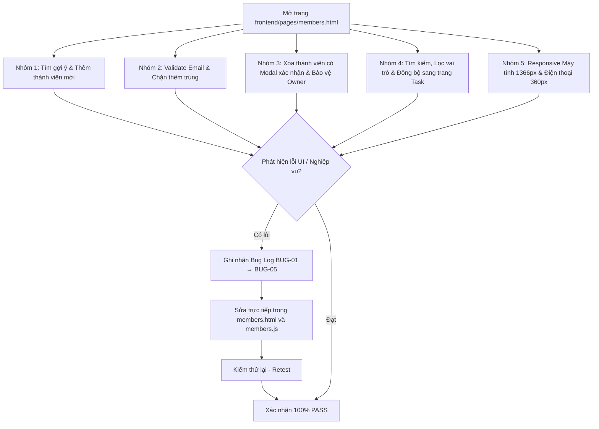

# BÁO CÁO KIỂM THỬ GIAO DIỆN THÀNH VIÊN DỰ ÁN (TASK TF16084)

- **Mã Task:** `TF16084`
- **Tên công việc:** `[Kiểm thử] Kiểm thử giao diện thành viên`
- **Người thực hiện:** Lê Quang Huy (B25DTCN245)
- **Sprint:** Sprint 3 (19/11 – 25/11)
- **Đối tượng kiểm thử:** [frontend/pages/members.html](../frontend/pages/members.html), [frontend/js/pages/members.js](../frontend/js/pages/members.js), [frontend/js/custom-select.js](../frontend/js/custom-select.js)
- **Thiết bị & Viewport kiểm thử:**
  - **Máy tính (Desktop):** `1366×768`, `1440×900` (Chrome, Safari, Edge)
  - **Máy tính bảng (Tablet):** `768×1024`
  - **Điện thoại (Mobile):** `360×800`, `390×844`

---

## 1. Sơ đồ luồng kiểm thử thao tác Thêm & Xóa thành viên

---

## 2. Bảng Test Cases chi tiết (Thêm/Xóa thành viên trên Máy tính & Điện thoại)

| Mã TC | Nhóm kịch bản | Thiết bị / Viewport | Bước thực hiện | Kết quả mong đợi | Kết quả thực tế | Trạng thái |
| :---: | :--- | :---: | :--- | :--- | :--- | :---: |
| **TC-01** | **Hiển thị danh sách ban đầu** | Desktop `1366px` | Mở `members.html?project_id=1` | Hiện đủ 5 thành viên nhóm, đúng vai trò (`OWNER` / `MEMBER`), ngày tham gia và tổng số `5` | Hiển thị chính xác, tải từ API / `localStorage` | **PASS** |
| **TC-02** | **Tìm gợi ý người dùng theo email** | Desktop `1366px` | Gõ `"chi"` hoặc `"ptit"` vào ô email `#member-email-input` | Hiện dropdown gợi ý có highlight từ khóa, Avatar chữ cái; thành viên đã trong dự án bị khóa (`Đã trong dự án`); bấm chọn hiện chip `Đã chọn` | Gợi ý mượt sau 250ms debounce, phím `↑/↓/Enter/Esc` hoạt động | **PASS** |
| **TC-03** | **Thêm thành viên hợp lệ (`MEMBER` / `OWNER` / `VIEWER`)** | Desktop & Mobile | Chọn `chi.pq@ptit.edu.vn` + vai trò `MEMBER` (hoặc `OWNER`), bấm `Thêm thành viên` | Thêm dòng mới vào bảng, tổng thành viên tăng từ `5` → `6`, hiện Toast & Banner thành công, xóa trống ô nhập | Thêm thành công, không còn vai trò `ADMIN` dư thừa | **PASS** |
| **TC-04** | **Validate email rỗng & sai định dạng** | Desktop & Mobile | Để trống hoặc nhập `"abc@khonghople"`, bấm `Thêm thành viên` | Chặn submit, viền ô đỏ (`.is-invalid`), hiện lỗi inline `"Vui lòng nhập email..."` / `"Định dạng email không hợp lệ"` | Validate chính xác | **PASS** |
| **TC-05** | **Chặn thêm trùng thành viên đã trong dự án** | Desktop `1366px` | Nhập email `duc.nm@ptit.edu.vn` đã có trong dự án, bấm `Thêm thành viên` | Từ chối thêm, báo lỗi `"Người dùng với email này đã có trong dự án."`, không sinh dòng trùng | Chặn trùng 100% | **PASS** |
| **TC-06** | **Xóa thành viên có Modal xác nhận (Hủy bỏ)** | Desktop & Mobile | Bấm `Xóa khỏi dự án` ở dòng `Lưu Đức Anh` → bấm `Hủy bỏ` hoặc nhấn phím `Escape` | Mở Modal hiển thị đúng tên & email thành viên; khi hủy/nhấn `Esc` thì đóng Modal và giữ nguyên thành viên | Đóng Modal mượt, không xóa nhầm | **PASS** |
| **TC-07** | **Xóa thành viên có Modal xác nhận (Xác nhận xóa)** | Desktop & Mobile | Bấm `Xóa khỏi dự án` ở dòng `Phạm Quỳnh Chi` → bấm `Xác nhận xóa` | Xóa dòng khỏi bảng, tổng thành viên giảm xuống, hiện Toast `"Đã xóa thành viên..."`, đồng thời mở khóa lại trong ô gợi ý email | Xóa thành công & đồng bộ | **PASS** |
| **TC-08** | **Bảo vệ Chủ dự án (Owner cuối cùng)** | Desktop `1366px` | Kiểm tra cột `Thao tác` ở dòng `Lê Quang Huy (OWNER)` | Không hiển thị nút `Xóa khỏi dự án`, thay bằng nhãn `Chủ dự án` (tuân thủ `BR-02`, `BR-18`) | Khóa xóa Owner an toàn | **PASS** |
| **TC-09** | **Tìm kiếm & Lọc theo vai trò trong bảng** | Desktop `1366px` | Gõ `"Long"` vào ô tìm bảng; chọn lọc `OWNER` / `MEMBER` / `VIEWER` | Bảng lọc đúng thành viên tương ứng; khi không khớp hiện thông báo `"Không tìm thấy thành viên phù hợp."` | Lọc realtime chính xác | **PASS** |
| **TC-10** | **Đồng bộ thành viên sang trang Task (`tasks.html`)** | Desktop `1366px` | Thêm thành viên mới ở `members.html`, chuyển sang tab `Danh sách Task` → mở Modal Tạo Task | Thành viên mới thêm xuất hiện ngay trong dropdown `Người phụ trách (Assignee)` và `Avatar Stack` | Đồng bộ 2 chiều qua `localStorage` & API | **PASS** |
| **TC-11** | **Đổi trạng thái dự án (Owner/Admin)** | Desktop `1366px` | Owner đổi trạng thái dự án sang `Lên kế hoạch` / `Đã hoàn thành` | Cập nhật Badge trạng thái ngay lập tức, đồng bộ sang `tasks.html` và `projects.html`; Member thường bị khóa | Hoạt động chuẩn phân quyền | **PASS** |
| **TC-12** | **Hiển thị Responsive trên Điện thoại** | Mobile `360×800` | Kiểm tra Header, Form thêm thành viên, Dropdown gợi ý, Bảng danh sách và Modal xóa trên `360px` | Header tự giãn không tràn; Form & Dropdown xếp full-width `100%`; bảng cuộn ngang gọn không vỡ chữ nút `Xóa khỏi dự án`; Modal vừa màn hình | Đạt chuẩn `NFR-004` | **PASS** |

---

## 3. Nhật ký lỗi đã phát hiện & khắc phục (Bug Log)

| Mã Bug | Mức độ | Mô tả lỗi phát hiện khi kiểm thử | Nguyên nhân | Cách đã khắc phục | Trạng thái |
| :---: | :---: | :--- | :--- | :--- | :---: |
| **BUG-01** | Cao | Trên điện thoại `360px`, `members.html` thiếu CSS responsive khiến Header (`height: 72px`) bị tràn dòng, form thêm thành viên và thanh lọc xếp lệch cột | Chưa khai báo media query `@media (max-width: 768px)` cho trang `members.html` | Bổ sung đầy đủ quy tắc `@media (max-width: 768px)` cho `.header-inner`, `.project-subnav`, `.autocomplete-wrap`, `#add-member-form`, `.toolbar` và `.modal` | **Đã sửa (Fixed)** |
| **BUG-02** | Trung bình | Khi co màn hình xuống điện thoại `360px`, nút `Xóa khỏi dự án` trong cột Thao tác bị xuống thành 2–3 dòng gây xấu bảng | Bảng `.table` không có `min-width` và nút `.btn-remove-member` không có `white-space: nowrap` | Thêm `min-width: 640px` cho `.table` (cuộn ngang êm trong `.table-wrap`) và `white-space: nowrap` cho `.btn-remove-member` | **Đã sửa (Fixed)** |
| **BUG-03** | Trung bình | Khi mở Modal xác nhận xóa thành viên (`#delete-member-modal`), bấm phím `Escape` trên bàn phím không đóng được Modal | Chưa đăng ký listener `keydown` cho phím `Escape` trên `document` | Bổ sung sự kiện `keydown` kiểm tra `e.key === "Escape"` để đóng `#delete-member-modal` nhanh chóng | **Đã sửa (Fixed)** |
| **BUG-04** | Trung bình | Bảo vệ không xóa Owner chỉ kiểm tra cứng `m.id === 1`, có thể mất tác dụng nếu ID chủ dự án từ Backend khác `1` | Điều kiện `isPrimaryOwner` phụ thuộc cứng vào `Number(m.id) === 1` | Nâng cấp thành `roleUpper === "OWNER" && (Number(m.id) === 1 || ownerCount <= 1)` để luôn bảo vệ Owner cuối cùng của dự án | **Đã sửa (Fixed)** |
| **BUG-05** | Thấp | Sau khi xóa thành viên, nếu menu gợi ý email đang mở thì trạng thái `Đã trong dự án` chưa tự cập nhật lại thành `Chọn` | Chưa gọi lại `fetchUserSuggestions()` sau khi xóa thành viên thành công | Gọi làm mới `fetchUserSuggestions()` ngay sau khi xóa thành viên nếu menu gợi ý đang mở | **Đã sửa (Fixed)** |

---

## 4. Kết luận kiểm thử

- **Tổng số Test Cases:** `12 / 12` (**100% PASS** sau khi sửa lỗi)
- **Tổng số lỗi phát hiện & đã xử lý:** `5 / 5` (**100% Fixed**)
- **Đánh giá:** Trang quản lý thành viên (`members.html` + `members.js`) vận hành ổn định toàn bộ luồng xem danh sách, tìm gợi ý email, thêm mới, xóa có xác nhận, bảo vệ quyền Owner và hiển thị sắc nét trên cả máy tính (`1366px`) lẫn điện thoại (`360px`).
