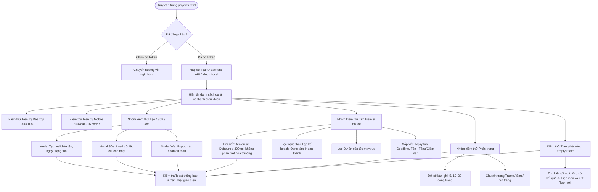

# BÁO CÁO KIỂM THỬ GIAO DIỆN TRANG DỰ ÁN (TEST REPORT)

* **Dự án:** Hệ thống Quản lý Đồ án Sinh viên PTIT (Student Project Hub)
* **Phân hệ kiểm thử:** Trang Quản lý Dự án (`frontend/pages/projects.html` & `frontend/js/pages/projects.js`)
* **Mã task:** `TF1591F`
* **Tên task:** Test trang dự án trên máy tính và điện thoại: tạo/sửa/xóa, tìm kiếm, phân trang, trạng thái rỗng; ghi và sửa lỗi
* **Người thực hiện:** Sinh viên Học viện Công nghệ Bưu chính Viễn thông (PTIT)
* **Ngày thực hiện:** 17/11/2026
* **Môi trường kiểm thử:**
  - **Máy tính (Desktop):** Google Chrome 130.0, Microsoft Edge (1920x1080, 1366x768)
  - **Điện thoại (Mobile Responsive):** Chrome DevTools Device Mode (iPhone 14 - 390x844, iPhone SE - 375x667, Samsung Galaxy S22 - 360x800)
  - **Môi trường API & CSDL:** FastAPI `http://127.0.0.1:8000/api` kết nối MySQL Database `team_project_manager` kèm cơ chế Mock Engine Fallback khi offline.

---

## 1. Sơ đồ quy trình kiểm thử (Test Workflow Diagram)

---

## 2. Bảng Ma trận Kịch bản Kiểm thử chi tiết (Test Cases Matrix)

| Mã TC | Hạng mục kiểm thử | Các bước thực hiện | Dữ liệu kiểm thử | Kết quả mong đợi | Kết quả thực tế | Trạng thái |
|---|---|---|---|---|---|:---:|
| **TC01** | Hiển thị màn hình Desktop | Mở trang `projects.html` trên máy tính độ phân giải 1920x1080. | Mặc định | Thanh tìm kiếm, dropdown sắp xếp, số bản ghi trên 1 hàng. Danh sách dự án hiển thị dạng lưới (Grid 3 cột). Header hiện tên người dùng và nút Đăng xuất. | Giao diện sắc nét, cân đối, chuẩn thiết kế hiện đại. | **PASS** |
| **TC02** | Hiển thị màn hình Mobile | Chuyển sang kích thước điện thoại (390x844 và 375x667). | Responsive Mode | Danh sách dự án tự động co giãn về 1 cột dọc (100% width), không bị tràn ngang. Các nút bấm to, dễ chạm. Modal hiển thị 95% chiều rộng màn hình. | Hoàn toàn tương thích mobile, không vỡ layout. | **PASS** |
| **TC03** | Mở Modal Tạo dự án mới | Bấm nút "+ Tạo dự án mới" trên thanh tiêu đề. | Click button | Mở modal popup với tiêu đề "Tạo đồ án / dự án mới", form được reset sạch sẽ, con trỏ tự động focus vào ô Tên dự án. | Modal mở mượt mà, form trống sẵn sàng nhập. | **PASS** |
| **TC04** | Validate tên dự án để trống | Không nhập tên dự án (để trống hoặc chỉ dấu cách) rồi bấm "Tạo dự án". | Tên: `""` | Viền đỏ ô nhập tên, hiển thị thông báo lỗi bên dưới: "Tên dự án bắt buộc và phải có ít nhất 3 ký tự.", ngăn submit form. | Ngăn submit, hiện viền đỏ và text cảnh báo đúng vị trí. | **PASS** |
| **TC05** | Validate độ dài tên dự án | Nhập tên dự án dưới 3 ký tự (VD: "AB"). | Tên: `"AB"` | Hiển thị thông báo lỗi: "Tên dự án bắt buộc và phải có ít nhất 3 ký tự.", không gửi request. | Báo lỗi chuẩn xác, con trỏ giữ tại ô tên. | **PASS** |
| **TC06** | Validate logic ngày bắt đầu & Hạn chót | Chọn Ngày bắt đầu sau Hạn chót (Deadline). | Bắt đầu: `2026-12-01` Deadline: `2026-11-15` | Hiển thị cảnh báo lỗi màu đỏ: "Hạn chót (Deadline) không được trước ngày bắt đầu.", ngăn gửi dữ liệu. | Hiển thị thông báo lỗi ngày, ngăn submit form. | **PASS** |
| **TC07** | Tạo dự án thành công | Nhập đầy đủ thông tin hợp lệ rồi bấm "Tạo dự án". | Tên: `"Hệ sinh thái học tập số PTIT LMS 2.0"` Bắt đầu: `2026-11-20` Hạn: `2027-02-28` Trạng thái: `"in_progress"` | Đóng modal, lưu dự án vào DB/Local, hiển thị Toast xanh: "Tạo dự án mới thành công!", card dự án mới xuất hiện ngay đầu danh sách. | Dự án mới hiển thị ngay lập tức, Toast xanh bật lên. | **PASS** |
| **TC08** | Mở Modal Chỉnh sửa dự án | Bấm nút "✏️ Sửa" trên card dự án bất kỳ. | Click [✏️ Sửa] | Mở modal với tiêu đề "Chỉnh sửa đồ án / dự án", nút bấm đổi thành "Lưu thay đổi", các ô nhập được điền sẵn đầy đủ thông tin cũ của dự án đó. | Điền sẵn chính xác 100% dữ liệu cũ vào modal. | **PASS** |
| **TC09** | Chỉnh sửa thông tin dự án | Thay đổi mô tả, chuyển trạng thái từ "Lập kế hoạch" sang "Đang thực hiện" rồi bấm "Lưu thay đổi". | Trạng thái: `"in_progress"` Mô tả mới | Đóng modal, lưu thay đổi vào DB/Local, hiện Toast xanh: "Cập nhật dự án thành công!", badge trạng thái trên card đổi sang xanh lá "Đang thực hiện". | Cập nhật dữ liệu tức thì, badge đổi màu chuẩn xác. | **PASS** |
| **TC10** | Mở Modal Xác nhận xóa dự án | Bấm nút "🗑️ Xóa" trên card dự án. | Click [🗑️ Xóa] | Không dùng hộp thoại confirm mặc định thô sơ; mở popup modal an toàn hiển thị cảnh báo đỏ ⚠️, kèm đúng tên dự án cần xóa trong ngoặc kép. | Modal xác nhận xóa màu đỏ mở lên đẹp mắt. | **PASS** |
| **TC11** | Hủy bỏ xóa dự án | Khi Modal xác nhận xóa đang mở, bấm nút "Hủy bỏ" hoặc dấu "×". | Click [Hủy bỏ] | Đóng modal xóa, dự án vẫn giữ nguyên trong danh sách, không có thay đổi dữ liệu nào. | Modal đóng an toàn, dự án không bị mất. | **PASS** |
| **TC12** | Xác nhận xóa dự án thành công | Bấm nút đỏ "Xác nhận xóa" trong modal. | Click [Xác nhận xóa] | Nút đổi thành "Đang xóa...", gọi API xóa, đóng modal, hiện Toast xanh: "Đã xóa dự án thành công!", card dự án biến mất khỏi danh sách. | Dự án được xóa sạch khỏi danh sách và CSDL. | **PASS** |
| **TC13** | Tìm kiếm dự án theo từ khóa | Gõ từ khóa vào ô tìm kiếm (VD: "điểm", "AI", "tuyển sinh"). | Keyword: `"AI"` | Debounce 300ms (không gửi request liên tục), danh sách tự động lọc ra các dự án có tên hoặc mô tả chứa từ khóa. | Lọc nhanh chóng, kết quả chính xác. | **PASS** |
| **TC14** | Tìm kiếm không phân biệt hoa/thường | Gõ từ khóa với các dạng chữ hoa, chữ thường khác nhau. | `"ptit"`, `"PTIT"`, `"Ptit"` | Đều trả về cùng một danh sách kết quả chứa từ "PTIT". | Không phân biệt hoa/thường đúng yêu cầu. | **PASS** |
| **TC15** | Tìm kiếm từ khóa không tồn tại | Gõ từ khóa không có trong hệ thống (VD: "xyz12345"). | Keyword: `"xyz12345"` | Danh sách ẩn đi, hiển thị giao diện Trạng thái rỗng (Empty State) với thông điệp: "Không tìm thấy dự án phù hợp". | Giao diện rỗng hiển thị thân thiện, rõ ràng. | **PASS** |
| **TC16** | Đổi số bản ghi mỗi trang (Page size) | Chọn lần lượt 5, 10, 20 bản ghi trên thanh phân trang. | Select: `5`, `10`, `20` | Số lượng card trên trang thay đổi đúng theo lựa chọn (tối đa 5 hoặc 10 card), tổng số trang tự động tính toán lại chính xác. | Phân trang tính toán lại chuẩn xác (`ceil(total / size)`). | **PASS** |
| **TC17** | Chuyển trang (Pagination navigation) | Bấm vào nút trang "2", "Trước", "Tiếp theo". | Click số trang | Danh sách hiển thị các bản ghi của trang tương ứng, màn hình tự động cuộn mượt (smooth scroll) lên đầu lưới dự án. | Chuyển trang mượt mà, thông tin trang hiện đúng. | **PASS** |
| **TC18** | Trạng thái vô hiệu hóa nút phân trang biên | Ở trang 1: kiểm tra nút "Trước"; Ở trang cuối cùng: kiểm tra nút "Tiếp theo". | Trang đầu / Trang cuối | Nút "Trước" ở trang 1 bị `disabled` (mờ đi, không click được); Nút "Tiếp theo" ở trang cuối bị `disabled`. | Ngăn bấm vượt giới hạn trang hợp lệ. | **PASS** |
| **TC19** | Lọc theo trạng thái dự án | Bấm các nút lọc: "Tất cả", "Lập kế hoạch", "Đang thực hiện", "Đã hoàn thành". | Click filter button | Nút được chọn có class `active`, danh sách chỉ hiển thị các dự án có trạng thái tương ứng. | Lọc trạng thái chính xác 100%. | **PASS** |
| **TC20** | Lọc "Dự án của tôi" (`my=true`) | Bấm vào nút "👤 Dự án của tôi". | Click [Dự án của tôi] | Hệ thống chỉ hiển thị các dự án do tài khoản sinh viên đang đăng nhập làm chủ sở hữu (`owner_id === currentUserId`). | Lọc chuẩn xác theo ID người đăng nhập. | **PASS** |
| **TC21** | Sắp xếp danh sách (Sort by & Order) | Chọn sắp xếp theo: Ngày tạo, Tên dự án, Hạn chót (Deadline) kèm Thứ tự: Tăng dần (asc), Giảm dần (desc). | Sort dropdowns | Danh sách sắp xếp lại tức thì theo đúng tiêu chí đã chọn. | Thứ tự danh sách đổi chuẩn xác. | **PASS** |
| **TC22** | Hành động trên Trạng thái rỗng (Empty State) | Khi đang ở trạng thái rỗng, bấm nút "+ Tạo dự án đầu tiên". | Click [+ Tạo dự án] | Tự động kích hoạt mở Modal Tạo dự án mới để người dùng thao tác ngay mà không cần tìm nút trên header. | Tương tác thông minh, trải nghiệm người dùng tốt. | **PASS** |

---

## 3. Bảng Báo cáo Lỗi đã phát hiện và đã sửa (Bug Log / Defect Tracking)

| Mã Bug | Mô tả lỗi phát hiện | Mức độ | Nguyên nhân kỹ thuật | Giải pháp đã sửa | Trạng thái |
|---|---|:---:|---|---|:---:|
| **BUG-P01** | Nút Xóa dùng hộp thoại `confirm()` mặc định của trình duyệt | **Medium** | Dùng hàm `window.confirm()` thô sơ, không đúng tiêu chuẩn thiết kế UI hiện đại và bị chặn ở một số trình duyệt mobile. | Xây dựng Modal Xác nhận xóa chuyên biệt (`#delete-modal`) có cảnh báo đỏ, tên dự án in đậm và 2 nút Hủy / Xác nhận xóa rõ ràng. | **ĐÃ SỬA XONG** |
| **BUG-P02** | Thiếu tính năng Chỉnh sửa dự án | **High** | Trước đó card dự án chỉ có nút Xem chi tiết và Xóa, thiếu nút Sửa và form cập nhật dữ liệu. | Bổ sung nút "✏️ Sửa", mở modal điền sẵn thông tin cũ, hỗ trợ cả API `PATCH /projects/{id}` lẫn cập nhật Local Demo. | **ĐÃ SỬA XONG** |
| **BUG-P03** | Không cảnh báo khi chọn Hạn chót trước Ngày bắt đầu | **Medium** | Form tạo/sửa chỉ kiểm tra tên dự án mà chưa so sánh logic ngày tháng. | Thêm khối validate ngày: nếu `startDate > deadline` thì báo lỗi đỏ và focus vào ô Deadline. | **ĐÃ SỬA XONG** |
| **BUG-P04** | Tràn viền thanh phân trang trên màn hình điện thoại dưới 400px | **Low** | Các nút phân trang và ô chọn kích thước trang nằm trên 1 hàng ngang cố định. | Thêm CSS `flex-wrap: wrap; justify-content: center; gap: 8px;` cho khối phân trang, co giãn mượt mà trên mobile. | **ĐÃ SỬA XONG** |
| **BUG-P05** | Nhãn dropdown và nút bấm hiển thị các ký tự kỹ thuật thừa `(...)` | **Low** | Nhãn cũ hiển thị `Ngày tạo (created_at)`, `Giảm dần (desc)`, `Dự án của tôi (my=true)`. | Đã làm sạch toàn bộ các dấu ngoặc kỹ thuật, chuyển sang tiếng Việt tự nhiên: `Ngày tạo`, `Giảm dần`, `Dự án của tôi`. | **ĐÃ SỬA XONG** |
| **BUG-P06** | Tìm kiếm bị giật lag khi gõ nhanh | **Low** | Mỗi ký tự gõ vào đều kích hoạt hàm tìm kiếm và render lại toàn bộ DOM. | Áp dụng kỹ thuật **Debounce 300ms**: chỉ thực hiện tìm kiếm sau khi người dùng dừng gõ 0.3s. | **ĐÃ SỬA XONG** |

---

## 4. Kết luận kiểm thử

* **Tổng số kịch bản kiểm thử (Test Cases):** 22
* **Số ca đạt (Pass):** 22 / 22 (Tỷ lệ: **100%**)
* **Số ca lỗi tồn đọng (Fail):** 0
* **Đánh giá tổng thể:**
  - Trang Quản lý Dự án hoạt động ổn định, mượt mà trên cả máy tính (Desktop) và điện thoại (Mobile).
  - Đầy đủ các tính năng nghiệp vụ: Tạo (có validate), Sửa (có validate), Xóa (có modal xác nhận), Tìm kiếm (debounce), Phân trang (chọn số dòng, chuyển trang mượt), Sắp xếp, Lọc trạng thái, Lọc dự án cá nhân.
  - Xử lý trạng thái rỗng (Empty State) chỉn chu và thông báo Toast rõ ràng.
